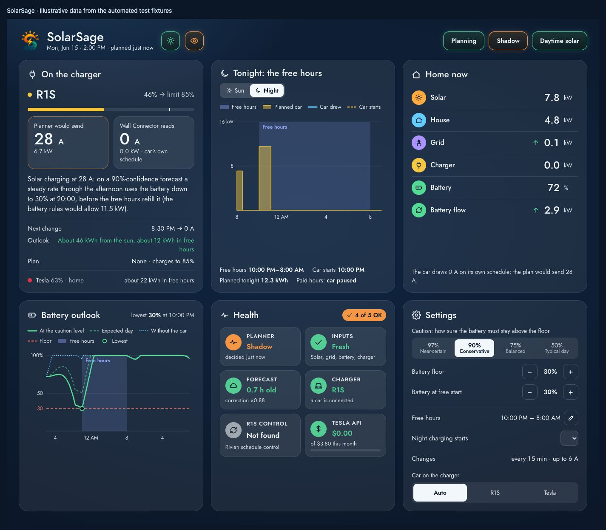
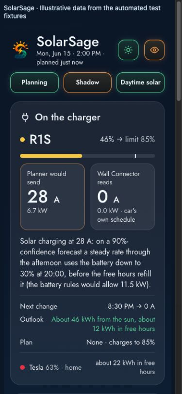

  

Forecast-aware solar EV charging for Home Assistant.

  <a href="https://bballdavis.github.io/SolarSage/">Documentation</a> ·
  <a href="docs/installation.md">Installation</a> ·
  <a href="https://github.com/bballdavis/SolarSage/issues">Issues</a>

SolarSage plans charging for a Tesla or Rivian on a shared charger, using solar forecasts, household demand, home battery reserves, electricity prices, and per-car targets. It explains the current it chooses and the battery path it expects, so you can understand a plan before enabling vehicle commands.

- **Use more daytime solar.** Plan steady charging currents around the energy available, with the home battery absorbing short-term swings.
- **Make use of free hours.** Charge at the vehicle's allowed full current during your configured free electricity windows.
- **See why.** One Home Assistant dashboard shows the plan, forecasts, battery outlook, car status and settings.
- **Start in shadow mode.** Inspect plans without sending commands. Bundled Rivian schedule control also starts in dry run.

## A look inside

<!-- Screenshots below use synthetic data, not a household recording. -->

Phone layout

The planner runs in Home Assistant. It reads your configured sensors and Solcast forecast, models household demand and the home battery, and selects a charging current. Tesla commands go through Tesla Fleet; the bundled Rivian controller manages charging schedules with leases, fault handling and restoration of the original schedules. The charger provides measurement; SolarSage commands the car.

## Get started

You need Home Assistant 2026.10+, recorder history, solar/grid/battery sensors, charger power measurement, Solcast, and vehicle telemetry. The reference setup uses a Sol-Ark inverter, a Tesla Wall Connector and one shared charger. Review the [requirements](docs/installation.md#requirements) for your setup.

Install **SolarSage** as a HACS custom integration, then add the site planner and, for a Rivian, its bundled schedule controller. [Installation and upgrades →](docs/installation.md)

**Experimental:** automated tests use simulated systems. Real-system commissioning is still required. Follow the [staged testing guide](docs/TESTING.md) before turning off shadow mode or dry run. SolarSage is not yet listed in the HACS default catalog.

## Read more

[Full documentation](https://bballdavis.github.io/SolarSage/) · [Configuration](docs/PLANNER.md) · [How it works](docs/PLAN.md) · [Rivian control](docs/RIVIAN_SCHEDULE_CONTROL.md) · [Contributing](CONTRIBUTING.md)

Documentation is built directly from `docs/` with Docusaurus and deployed to GitHub Pages on `main`. The internal integration ID remains `solar_ev_planner` for compatibility. Licensed under [MIT](LICENSE).
