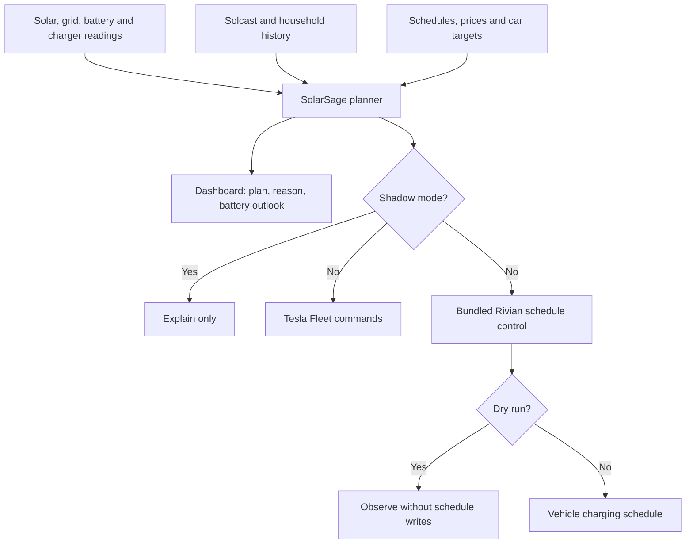

# How SolarSage works

## Goal

Use available solar energy for EV charging while protecting the home battery and meeting charging targets. Make each decision inspectable in Home Assistant before allowing commands.

## What we use

SolarSage combines sensor readings, recorder statistics, Solcast forecasts, Schedule helpers, vehicle telemetry, and the vehicle's charging controls. The example installation uses a Sol-Ark battery inverter and a Tesla Wall Connector shared by a Tesla and a Rivian. Every entity mapping must be reviewed for your installation.

## How it works

## The planner

Every minute it reads the site and checks safety conditions. About every 15 minutes, and after important changes, it replans a steady current for the vehicle on the charger. House use is inferred as solar + grid − battery − charger, using normalized units and signs.

The daytime plan considers forecast uncertainty, recent household demand, the battery's predicted path, available storage, and car targets. It smooths current changes and explains why a request waits. The [design reference](PLANNER_DESIGN.md) describes the algorithm and the limits of its historical simulations.

## Electricity plans

A Schedule helper defines any free hours. Additional Schedule helpers define price windows; the import and export prices cover remaining hours. During free hours the car charges at its allowed full current to its limit. The model assumes the inverter refills the home battery in those hours; **configure that on the inverter**, because SolarSage does not command it.

All capacities, prices, currents, and schedules in these docs are examples. Enter your equipment ratings and tariff.

## Dashboard

Add `custom:solar-ev-planner-card` to a Home Assistant dashboard after installing SolarSage. The integration registers the card automatically. It shows the current mode, reason, car on the charger, forecasts, battery outlook, health and settings. Its header uses the SolarSage logo and name.

## Phases

Follow [commissioning](TESTING.md): validate inputs, collect and replay real days, observe shadow plans, test Tesla commands attended, then trial Rivian schedule control before combining live operation.

### Phase 0: the Tesla checklist

Set up Home Assistant's [Tesla Fleet integration](https://www.home-assistant.io/integrations/tesla_fleet/) using its current instructions. Register the developer app, host its public key at your own domain, and pair the virtual key with the vehicle. Confirm that a command succeeds before connecting SolarSage. Remove competing command automations and review any duplicate integrations/entities.

### Phase 0: hosting the key through Traefik

If you already operate a reverse proxy, [the example rule](https://github.com/bballdavis/SolarSage/blob/main/deploy/traefik/tslakey.yml) exposes only Tesla's public-key path. Replace `tesla-key.example.com` and the internal Home Assistant address with your own values. Configure DNS, certificates and proxy trust for your environment. This file is an example, not a deployment tool.

Save **only the public PEM** under `/config/www/tesla/com.tesla.3p.public-key.pem`. Keep the private key outside `www`. Check from outside your LAN that the exact public-key URL returns HTTP 200 and an unrelated path returns 404. Never expose Home Assistant itself just to host this file.

### Phase 0: staying inside the free credit

Review Tesla's current [Fleet API billing documentation](https://developer.tesla.com/docs/fleet-api/billing-and-limits). Set account billing limits independently of SolarSage. Its spending guard estimates calls it makes; it cannot see other applications or guarantee your invoice. Pricing and credit amounts quoted in historical design notes describe their original assumptions.

### Phase 0: the Rivian app

Review the [Rivian setup guide](RIVIAN_SCHEDULE_CONTROL.md#install-and-configure). Turn off competing smart charging and schedule writers. Inventory your home schedule, verify its location pin, and resolve overlapping weekdays before giving SolarSage ownership. Leave dry run on until the attended trial.

### If the Rivian trial fails

Leave live control disabled. Restore the original schedules using the controller's recovery actions and verify them in the Rivian app. Preserve the journal and sanitized diagnostics. Do not force ownership over a fault you have not understood.

## Information needed

Before commissioning, record your usable battery capacity, charge/discharge limits, reserve, charger ratings, vehicle current ranges, tariff schedules, and the exact entities representing them. Configure the site's timezone correctly, particularly for Rivian schedule windows.

## Risks and unknowns

The automated test suite does not establish hardware compatibility. Vehicle cloud latency, stale telemetry, forecast errors, API changes and network outages affect operation. The uncertainty setting is a model input, not a measured reliability guarantee. Read [known limits](PLANNER.md#known-limits) and [fault recovery](RIVIAN_SCHEDULE_CONTROL.md#faults-and-recovery).
