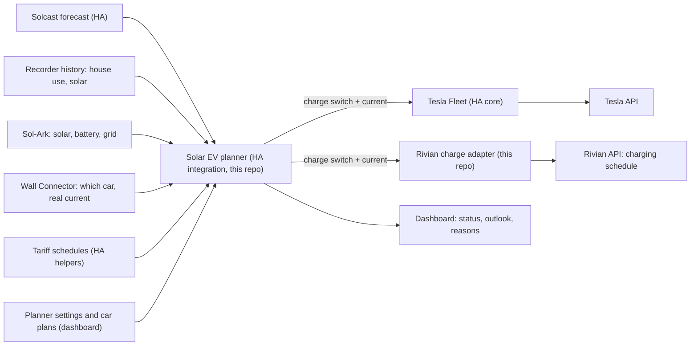

# Working plan: smart solar charging for the Tesla and the Rivian

Last updated: October 25, 2026. This is the plan we work from. Where it conflicts with the [architecture record](SOLAR_CHARGING_ARCHITECTURE.md) or the [roadmap](ROADMAP.md), this plan wins; both describe the earlier evcc-centred design and will be revised to match.

## Goal

Charge both cars from solar as much as possible without paying for grid power, with the home battery absorbing the swings. Charging should change gradually and predictably, not chase every cloud. It must be easy to see what is happening and to steer it from one Home Assistant dashboard.

## What we use

Only the hardware already in place:

| Piece | Role | How Home Assistant talks to it |
| --- | --- | --- |
| Home Assistant OS (Proxmox VM) | Runs everything below; already has real-time solar data, history and the Solcast forecast | — |
| Sol-Ark inverter and home battery (about 31 kWh usable) | Solar, house and battery measurements | Existing Sol-Ark integration |
| Tesla Wall Connector Gen 3 | **Measurement only**: power, current, whether a car is connected. Tesla publishes no way to set its current. | HA core Tesla Wall Connector integration (local) |
| Tesla | Charging on/off and current | Tesla's own API, through HA core **Tesla Fleet** |
| Rivian R1S (2025, Gen 2) | Charging current and pause, through its charging schedule | Rivian's API: upstream [`home-assistant-rivian`](https://github.com/bretterer/home-assistant-rivian) for data, this repo's [Rivian charge adapter](RIVIAN_CHARGE_ADAPTER.md) for control |

Only one car can be on the Wall Connector at a time, so only one car charges at a time.

## Decisions

Made:

1. **No new hardware.** Everything goes through the existing stack and the cars' and charger's APIs.
2. **Tesla through Tesla's API.** HA core Tesla Fleet, with the owner's own Tesla developer account. No Teslemetry, no Bluetooth hardware.
3. **Rivian through Rivian's API.** A Gen 2 has no remote start/stop or set-current command (those need a phone key that Gen 2 does not support yet). Its charging schedule is the only lever, and the adapter writes it. Other owners already solar-charge an R1S this way ([`rchav/rivian_solar_charge_ha`](https://github.com/rchav/rivian_solar_charge_ha)); nobody has published that it works on a Gen 2, so an attended trial confirms it for this car.
4. **The Wall Connector measures, the cars act.** Its readings are the ground truth for what the car really draws.
5. **A forecast-predictive planner decides the current**, not a reactive surplus follower (see [The planner](#the-planner)). It plans smooth currents from the forecast and recent usage, and lets the home battery absorb short-term swings.
6. **Electricity plans are configurable.** Today's plan has free hours from 8 PM to 6 AM, and that will change; time of use, flat and buyback plans must also work by changing settings, not code.
7. **One dashboard in Home Assistant** with built-in cards, plus the planner's settings.
8. **The planner controls the cars directly; evcc is not used** (October 25, 2026). evcc's core is a loop that follows the surplus every 30 seconds, which is what decision 5 replaces, and night charging in free hours is simple to do in the planner. Keeping evcc as a pass-through would leave two systems competing for the same controls. **Reversible:** the evcc config and glue package are in commit [`266b3bf`](https://github.com/bballdavis/HASS-Solar-Rivian/tree/266b3bf0f022fcccbcf3874c6511963aac61d711/config), and the Rivian adapter exposes the same switch and current number evcc would use, so bringing evcc back means installing the add-on and restoring one file.
9. **Cars charge at night by default.** The default charging window is 10 PM to 6 AM, inside the free hours; both are settings. Daytime solar charging is a second mode for days a car is plugged in during the day.

## How it works

## The planner

A Home Assistant integration in this repo, with two modes. A minute-by-minute safety check runs in both but acts only when something is wrong.

**Night charging (the default).** In the charging window (default 10 PM to 6 AM), the car on the charger charges at its full current until it reaches its plan target or its charge limit, then stops. The window must lie in free hours unless a plan cannot be met otherwise. If the window cannot deliver a plan's target by its time, the dashboard says so in the evening, and the shortfall is covered by the next day's solar or, if the owner allows it, paid hours. The home battery should not feed the car at night; see [Information needed](#information-needed).

**Daytime solar charging.** When a car is plugged in during the day, the planner plans its current every 15 minutes as described below.

**Inputs:** the Solcast forecast for today and tomorrow (half-hour slots with pessimistic, typical and optimistic values), actual solar and house use so far today, the last 7–14 days of house use from the recorder, battery level, which car is plugged in with its level, limit and plan, and the tariff schedule.

**How it decides:**

1. **Forecast as a range, corrected by today.** Each half-hour of the forecast is a bell curve (most likely value and spread). Today's actual production so far updates the rest of the day: in the morning the forecast dominates, by afternoon today's real behaviour does, and the uncertainty shrinks.
2. **Predict the battery, not just the moment.** Using that forecast and the house's usual demand, it predicts the battery level from now through the evening and night until the next refill (sunrise or free hours).
3. **The floor is a limit on the prediction.** If the predicted lowest battery level stays above the floor at the chosen confidence, draining the battery now is fine: the car keeps a steady current and the battery covers clouds. The planner changes the car's current only when the prediction says the floor, or paid grid power, is at risk.
4. **Cheapest energy first.** A car's need is filled from free tariff hours first, then solar that would otherwise be exported for little, then the battery within the floor rule, and paid grid only to meet a plan that cannot be met otherwise.
5. **Smooth current.** The car's share follows the shape of the forecast across the day, as a gentle rise and fall in amps. Changes are rate-limited (at most one every 15 minutes by default, a few amps at a time, small differences ignored). That also keeps Rivian schedule writes and billed Tesla commands to a few per hour.

**Safety rules that override the plan** (checked every minute):

- battery at the floor: reduce or pause the car;
- paid grid import for longer than the tolerance: reduce or pause;
- battery full and exporting for a while: allow an early increase;
- car unplugged, away, at its limit, or its data stale: stop commanding it;
- planner or Home Assistant down: the Rivian's charging window lapses on its own within about 25 minutes (adapter behaviour); the Tesla keeps its last current up to its own charge limit.

**Settings** (on the dashboard; defaults to be confirmed by the simulation):

| Setting | Default | Meaning |
| --- | --- | --- |
| Planner | on | Off leaves both cars alone |
| Free hours | 8 PM–6 AM daily | A Schedule helper; repaint it when the plan changes |
| Night charging window | 10 PM–6 AM | When the overnight car charges |
| Night charging current | the car's maximum | Lower it to spread the charge over the night |
| Daytime solar charging | on | Off means a car plugged in by day waits for the night window |
| Caution | conservative | How much of the forecast to count on, from "near-certain" to "typical day" |
| Battery floor | 30% | The predicted battery level must stay above this |
| Battery level wanted when free hours start | 40% | What the battery should still hold for the paid evening; with no free hours, at sunset |
| Minimum time between current changes | 15 min | |
| Largest single change | 6 A | |
| Paid grid tolerance | 5 min | How long paid import is accepted before the safety rule acts |
| Per car: charge limit | car's own | |
| Per car: plan | none | "X% by time T", optionally repeating on weekdays |
| Per car: plan shortfall | free hours, then steady | How to cover what the sun will not |

The full algorithm, its tuning and the simulation results go in `docs/PLANNER_DESIGN.md` once the design run finishes. Three candidate designs are being compared with an evcc-like reactive baseline on sunny, cloudy, mixed, bad-forecast, two-car and plan-deadline days.

## Electricity plans

Each plan is described with Home Assistant's **Schedule** helper, a weekly calendar where you paint the hours:

- one schedule per price level (for example "Free" and "Peak"), each with a price setting;
- a normal price for all other hours;
- a solar buyback rate.

When the plan changes, repaint the schedules in the HA UI. A real-time-price plan could later use a price sensor instead.

With **free nights**, the car plugged in overnight mostly charges in the free hours; daytime solar mainly fills the home battery for the paid evening and powers the house, and goes to a car when it would otherwise be exported cheaply or the car needs it before night. With one charger, only the overnight car gets the free hours; the dashboard shows which car should be plugged in tonight.

## Dashboard

One view, built-in cards only:

- **Now:** sun, house, battery (level and flow), grid, charger power; forecast left today and tomorrow.
- **On the charger:** which car, its level and limit, current and the next planned change, with the planner's reason in one sentence.
- **Each car:** level, limit, plan and its outlook ("covered by sun", "≈ 7 kWh in free hours", "≈ 3 kWh paid").
- **Battery outlook:** predicted level through tonight against the floor.
- **Settings:** the planner settings above and the tariff schedules.

## Phases

Each phase ends with a check that must pass before the next.

| Phase | Work | Done when |
| --- | --- | --- |
| 0. Prerequisites | Owner provides the [missing details](#information-needed). Register a Tesla developer app; host Tesla's public key on a domain you control (a free static site works). | All details recorded in this plan. |
| 1. Read everything | Add Tesla Fleet (approve the virtual key in the car). Install the Rivian adapter in dry run. Confirm Wall Connector, Sol-Ark, Solcast and both cars read correctly for a week, including which car is on the charger. | Every planner input is present and fresh; no control yet. |
| 2. Planner design | Finish the simulation, pick the design, write `PLANNER_DESIGN.md`. | Owner agrees with the behaviour on the simulated days. |
| 3. Build the planner | HA integration with tests: night charging first, then daytime solar charging; tariff schedules; dashboard. Runs in **shadow mode**: it plans and explains, but sends nothing. | A week of shadow plans that the owner finds sensible. |
| 4. Tesla under the planner | Let the planner command the Tesla. | A week with no unexpected paid import, few changes per day, plans met, and the Wall Connector confirming each change. |
| 5. Rivian trial | Attended trial with the adapter ([steps](RIVIAN_CHARGE_ADAPTER.md#attended-trial-roadmap-phase-3)): current changes, pause, lapse, exact restore of the owner's schedule. | The car follows schedule changes reliably. If it does not, decide between Rivian on a fixed schedule only or a controllable charger. |
| 6. Rivian under the planner | Let the planner command the Rivian through the adapter. | Same checks as phase 4, plus the owner's own Rivian schedule restored on unplug. |
| 7. Unattended | Notifications for faults and safety-rule trips; review a month of results. | A month without manual intervention. |

## Repository changes

- **Keep:** the Rivian charge adapter. It already takes a charge switch and a current number from any controller and writes the Rivian schedule safely.
- **Adapt:** the adapter's evcc-specific options (`evcc_liveness_entity`, `evcc_enabled_entity`) become a planner heartbeat, so the adapter still parks the Rivian if the planner stops.
- **Add:** the planner integration, the tariff helpers, the dashboard, `PLANNER_DESIGN.md`.
- **Retired:** the evcc config and the HA glue package (removed; last versions in [`266b3bf`](https://github.com/bballdavis/HASS-Solar-Rivian/tree/266b3bf0f022fcccbcf3874c6511963aac61d711/config)). The glue's useful logic moves into the planner, reusing that code: which car is on the Wall Connector, the vehicle override, the Tesla amp restore at unplug, and the stale-input check.
- **Revise:** the architecture record, roadmap and README to match this plan.

## Information needed

1. **The home battery at night.** Is the Sol-Ark set to hold the battery during free hours, so the house and the charging car run from the grid? If not, a car charging at 11 kW overnight drains the home battery, which then cannot cover the paid morning before the sun. This is an inverter setting (time-of-use slots); it may be adjustable from Home Assistant.
2. The price outside free hours, and the solar buyback rate.
3. When each car usually needs to be charged by, and which car is usually plugged in overnight.
4. The Tesla's model and year, and its maximum current on the Wall Connector (32 or 48 A).
5. A domain you control, for Tesla's public key.

Answered: free hours are 8 PM–6 AM for now (a setting); cars charge at night from 10 PM (a setting); evcc is removed (decision 8).

## Risks and unknowns

- **Gen 2 Rivian behaviour** is unconfirmed until the phase 5 trial.
- **Forecast quality** on fast-changing days: the planner leans on the battery and the safety rules there.
- **Tesla API cost and limits:** a few commands an hour stays within Tesla's monthly credit; verify on Tesla's developer dashboard in phase 4.
- **Internet down:** both cars' APIs are cloud services, so neither can be commanded. The Rivian's window lapses on its own; the Tesla keeps charging at its last current up to its limit.
- **The home battery feeding the car at night,** if the Sol-Ark is not set to hold it during free hours (information needed, item 1).
