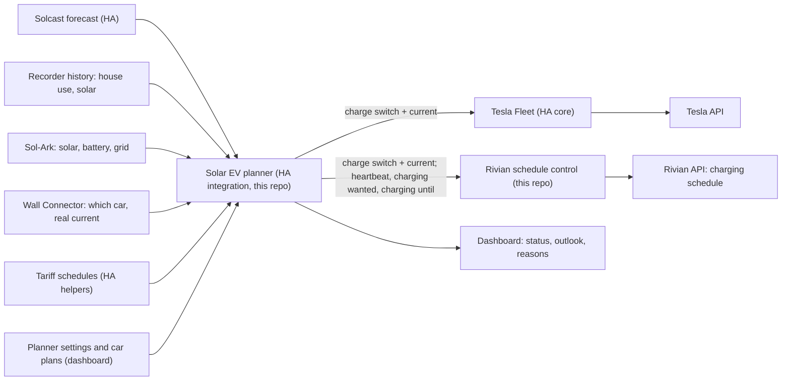

# Working plan: smart solar charging for the Tesla and the Rivian

Last updated: October 31, 2026. This is the plan we work from. Earlier designs and research notes are in git history.

**Where things stand:** Rivian schedule control, the planner integration and the real-data test tools are built and tested against fakes only. Nothing has run against the real cars, charger or Home Assistant yet. The next step is the owner's: the [phase 0 checklists](#phase-0-the-tesla-checklist) and the [decisions](#information-needed) come first, then [TESTING.md](TESTING.md) walks through phases 1 to 6. [Open items](#open-items) lists what remains.

## Goal

**The main purpose: plug a car in during the day and it charges from excess solar, with as little paid grid power as possible.** The home battery absorbs the swings. A car plugged in overnight charges in the free hours by default. Charging should change gradually and predictably, not chase every cloud. It must be easy to see what is happening and to steer it from one Home Assistant dashboard.

## What we use

Only the hardware already in place:

| Piece | Role | How Home Assistant talks to it |
| --- | --- | --- |
| Home Assistant OS (Proxmox VM) | Runs everything below; already has real-time solar data, history and the Solcast forecast | — |
| Sol-Ark inverter and home battery (about 31 kWh usable) | Solar, house and battery measurements | Existing Sol-Ark integration |
| Tesla Wall Connector Gen 3 | **Measurement only**: power, current, whether a car is connected. Tesla publishes no way to set its current. | HA core Tesla Wall Connector integration (local) |
| Tesla | Charging on/off and current | Tesla's own API, through HA core **Tesla Fleet** |
| Rivian R1S (2025, Gen 2) | Charging current and pause, through its charging schedule | Rivian's API: upstream [`home-assistant-rivian`](https://github.com/bretterer/home-assistant-rivian) for data, this repo's [Rivian schedule control](RIVIAN_SCHEDULE_CONTROL.md) for control |

Only one car can be on the Wall Connector at a time, so only one car charges at a time.

## Decisions

Made:

1. **No new hardware.** Everything goes through the existing stack and the cars' and charger's APIs.
2. **Tesla through Tesla's API.** HA core Tesla Fleet, with the owner's own Tesla developer account. Tesla Fleet signs commands itself, so no tesla-http-proxy add-on and no Docker are needed. No Bluetooth hardware. HA core Teslemetry is the fallback if Tesla's partner registration fails ([phase 0](#phase-0-the-tesla-checklist)). tesla_custom is removed once Tesla Fleet works.
3. **Rivian through Rivian's API.** As of October 31, 2026, the charging schedule's amperage is the only way to set a Rivian's current, on any generation and any path. No API command sets the current. This repository's Rivian schedule control (software in Home Assistant, no extra hardware) writes the schedule.
   - **Start/stop and the charge limit** need a phone key. On a Gen 2 a key can be paired only from a Mac, through an unofficial proof of concept ([upstream issue #181](https://github.com/bretterer/home-assistant-rivian/issues/181)). It gives no current control and is outside the Home-Assistant-only setup, so it is out of scope.
   - **Rivian's newer Parallax channel** has no proven charging write, so it is not used.
   - **Prior art:** other owners solar-charge a Rivian through the schedule: [`rchav/rivian_solar_charge_ha`](https://github.com/rchav/rivian_solar_charge_ha), [`ostap-korkuna/rivian-charging-automation`](https://github.com/ostap-korkuna/rivian-charging-automation), [`peterchester/rivian-tesla-solar-charging`](https://github.com/peterchester/rivian-tesla-solar-charging) and [`rjpease/RivianEVCC`](https://github.com/rjpease/RivianEVCC). RivianEVCC runs the same setup as here: an R1S on a Wall Connector Gen 3, with the Wall Connector as the ground truth.
   - **Nobody has published that it works on a Gen 2,** so the attended trial (phase 5) is the gate. If the car does not follow short windows, the fallback is [community-pattern mode](#if-the-rivian-trial-fails).
4. **The Wall Connector measures, the cars act.** Its readings are the ground truth for what the car really draws.
5. **A forecast-predictive planner decides the current**, not a reactive surplus follower (see [The planner](#the-planner)). It plans smooth currents from the forecast and recent usage, and lets the home battery absorb short-term swings.
6. **Electricity plans are configurable.** Today's plan has free hours from 8 PM to 6 AM, and that will change; time of use, flat and buyback plans must also work by changing settings, not code.
7. **One dashboard in Home Assistant** with built-in cards, plus the planner's settings.
8. **The planner controls the cars directly; evcc is not used** (October 25, 2026). evcc's core is a loop that follows the surplus every 30 seconds, which is what decision 5 replaces, and night charging in free hours is simple to do in the planner. Keeping evcc as a pass-through would leave two systems competing for the same controls. **Reversible:** the evcc config and glue package are in commit [`c2a4303`](https://github.com/bballdavis/HASS-Solar-Rivian/tree/c2a4303ad0c1386be10f99023b937848c129eca2/config), and Rivian schedule control exposes the same switch and current number evcc would use, so bringing evcc back means installing the add-on and restoring one file.
9. **Plugging in by day starts solar charging; overnight is the default otherwise.** A car plugged in during the day charges from excess solar automatically. A car on the charger in the free hours charges at its full current from the moment they begin until it reaches its charge limit; there is nothing else to plan then. The free hours are a Schedule helper (8 PM to 6 AM for now). **The Rivian gets one schedule write per free night** (October 25, 2026): one window at full current that ends exactly when the free hours end, written once. It is not renewed, it is not parked while the planner is down (Planning off at night leaves it charging on free power until then), and nothing is written at 6 AM. By day the Rivian keeps its short, renewed windows.
10. **The energy-budget planner** (October 25, 2026). Of three designs simulated against an evcc-like follower, the one that sets one steady current from the predicted battery path was chosen: it is as good as the best on the owner's tariff, holds up on plans, and is the simplest to explain ([PLANNER_DESIGN.md](PLANNER_DESIGN.md)). The simulation came before decisions 9 and 14 took their present form; [The planner](#the-planner) says what it assumed.
11. **Shadow mode first.** The planner installs in shadow mode and sends nothing until the owner turns it off; Rivian schedule control installs in dry run.
12. **Paid power only for plans.** Without a plan, the planner never chooses paid power. A plan's remainder that sun, battery and free hours cannot cover is charged from paid hours.
13. **One repository, two integrations.** HACS installs one integration per repository, so it installs Rivian schedule control, and the planner is copied by hand ([PLANNER.md, install](PLANNER.md#install)).
14. **The home battery refills in free hours** (October 25, 2026). The Sol-Ark's own settings charge it from the grid during the free hours, so every paid day starts at 100%; the planner leaves this to the inverter. Its prediction assumes the same: in the free hours it charges the battery at its maximum charge power (9 kW by default) until it is full, and never discharges it. Whatever the battery still holds when the free hours begin would be replaced for free overnight, so a car plugged in by day may also use that energy, spread over the afternoon, down to the level wanted at free start (default: the floor). Raising that level keeps more in the battery.
15. **Whichever car is plugged in charges.** The cars take turns on the one Wall Connector; the planner identifies the car on the charger and commands only that one ([PLANNER_DESIGN.md, two cars](PLANNER_DESIGN.md#7-two-cars)).

## How it works



## The planner

A Home Assistant integration in this repo ([PLANNER.md](PLANNER.md): install, configuration, entities), with two modes chosen by when the car is on the charger. A minute-by-minute safety check acts only when something is wrong; its paid-import and battery rules apply in paid hours, since import is free otherwise.

**Daytime solar charging (the main purpose).** Plugging a car in during the day starts it automatically, with no app or button. The goal is to put excess solar into the car while keeping paid grid import as low as possible. Every 15 minutes the planner plans the car's current as described below. If the car is still below its charge limit when the free hours begin, night charging takes over.

**Night charging (the default overnight).** Throughout the free hours, from the moment they begin or the car is plugged in, the car on the charger charges at its full current (its own maximum, capped by the Wall Connector's) until it reaches its charge limit, then stops. For the Rivian that is one charging-schedule window to the end of the free hours, written once (decision 9). The dashboard shows this mode as "Free hours". If sun, battery and free hours together cannot deliver a plan's target by its time, the car's outlook says so, and the remainder is charged from paid hours: at once when the deadline falls inside today's solar window, otherwise in the cheapest paid hours as late as possible. The home battery does not feed the car at night: the Sol-Ark's own settings charge it from the grid during the free hours, so each paid day starts full (decision 14).

Daytime solar charging works like this:

**Inputs:** the Solcast forecast for today and tomorrow (half-hour slots with pessimistic, typical and optimistic values), actual solar and house use so far today, recent house use from the recorder (the last 14 days, weighted toward the most recent, weekdays and weekends kept apart), battery level, which car is plugged in with its level, limit and plan, and the tariff schedule.

**Nothing seasonal is fixed.** Day length, expected solar, house demand and the reserve the battery needs all come from the current forecast and recent use every time the planner runs. The same settings therefore behave sensibly in June and in December: a short winter day or a summer evening with air conditioning simply leaves less for the car.

**How it decides:**

1. **Forecast as a range, corrected by today.** Each half-hour of the forecast is a bell curve (most likely value and spread). Today's actual production so far updates the rest of the day: in the morning the forecast dominates, by afternoon today's real behaviour does, and the uncertainty shrinks.
2. **Predict the battery, not just the moment.** Using that forecast and the house's usual demand, it predicts the battery level from now through tonight's free hours and the next day, until the following free hours begin (or until tomorrow's sunset when there are no free hours). In the free hours the prediction charges the battery to full, as the Sol-Ark does.
3. **The floor is a limit on the prediction.** If the predicted lowest battery level stays above the floor at the chosen confidence, draining the battery now is fine: the car keeps a steady current and the battery covers clouds. The planner changes the car's current only when the prediction says the floor, or paid grid power, is at risk.
4. **Excess solar first, paid grid last.** By day the car takes the solar the house and the battery's predicted needs do not. When free hours are coming, the Sol-Ark will refill the battery in them, so the car also gets the battery energy that would be left above the wanted level (default: the floor) when they begin: one steady current through the afternoon that sun and battery can carry without paid grid power on a cautious day. Paid grid power is used only when a plan cannot be met by solar, the battery and the next free hours.
5. **Smooth current.** The car's share follows the shape of the forecast across the day, as a gentle rise and fall in amps. Changes are rate-limited (at most one every 15 minutes by default, a few amps at a time, small differences ignored). That also keeps Rivian schedule writes and billed Tesla commands to a few per hour.

**Safety rules that override the plan** (checked every minute):

- battery at the floor: reduce or pause the car;
- paid grid import for longer than the tolerance: reduce or pause;
- battery full and exporting for a while: allow an early increase;
- car unplugged, away, at its limit, or its data stale: stop commanding it;
- planner off or unable to plan: its heartbeat goes unavailable, and by day Rivian schedule control parks the Rivian's charging window after 3 minutes; in the free hours the Rivian's window runs on to their end; the Tesla keeps its last current up to its own charge limit;
- Home Assistant down: the Rivian's charging window ends on its own, by day within about 25 minutes (schedule control behaviour; not in the community-pattern fallback), in the free hours when they end; the Tesla keeps its last current up to its own charge limit.

**Settings** (entities of the planner, listed in [PLANNER.md](PLANNER.md#settings); the defaults held up in the simulation, apart from the battery level wanted when free hours start, which it ran at 40%):

| Setting | Default | Meaning |
| --- | --- | --- |
| Planner | on | Off: no plans, nothing sent. The Tesla keeps its last current. By day Rivian schedule control parks the Rivian's charging window within minutes; in the free hours the Rivian charges on until they end. |
| Shadow mode | on | Plan and explain, send nothing. Turned off by the owner in phases 4 and 6. |
| Free hours | 8 PM–6 AM daily | A Schedule helper; repaint it when the plan changes |
| Price outside free hours | $0.32/kWh | Used to weigh paid grid power against other choices |
| Solar buyback | $0.00/kWh | What exported solar earns |
| Daytime solar charging | on | On: plugging in by day starts solar charging. Off: a car plugged in by day waits for the free hours |
| Caution | conservative | How much of the forecast to count on, from "near-certain" to "typical day" |
| Battery floor | 30% | The predicted battery level must stay above this |
| Battery level wanted when free hours start | 30% (the floor) | What the battery should still hold when the free hours begin; the Sol-Ark refills it in the free hours, so by default the car may use the battery down to the floor. Raise it to keep more in the battery (and cycle it less). With no free hours, checked at sunset |
| Minimum time between current changes | 15 min | |
| Largest single change | 6 A | |
| Paid grid tolerance | 5 min | How long paid import is accepted before the safety rule acts |
| Per car: charge limit | car's own | |
| Per car: plan | none | "X% by time T", once or on weekdays, every day or weekends |

The algorithm, its tuning and the simulation results are in [PLANNER_DESIGN.md](PLANNER_DESIGN.md). On the owner's tariff over 453 simulated days, it cut car-caused paid import from 179 kWh (an evcc-like follower) to 2.6 kWh, and current changes from 29 a day to 3.7; every simulated plan was met. Those runs came before the present free-hours behaviour: they charged the car in a 10 PM–6 AM window and had the home battery hold its level in the free hours, with 40% wanted when they began, so they do not cover charging from the start of the free hours, the refill or the spread of the battery's spare energy over the afternoon.

## Electricity plans

Each plan is described with Home Assistant's **Schedule** helper, a weekly calendar where you paint the hours:

- the free hours as one schedule, at $0;
- each other price level (for example "Peak") as a **price window**: its own schedule and a price entity;
- a normal price for all other hours (default $0.32/kWh);
- a solar buyback rate.

When the plan changes, repaint the schedules in the HA UI. A real-time-price plan could later use a price sensor instead. [PLANNER.md](PLANNER.md#electricity-plans) shows how free nights, time of use, flat and free weekends are set up.

With **free nights**, a car plugged in by day takes the solar left after the house and what the battery needs to carry the house until the free hours begin, and the battery energy above the wanted level when they begin, which the Sol-Ark replaces from the grid in the free hours. That reserve is worked out each time from the forecast and recent evening use, so it grows on short or cloudy days and shrinks on long sunny ones. A car on the charger in the free hours charges at its full current. Free hours by day, such as a free weekend, work the same way. With one charger, only the overnight car gets the free hours; the dashboard shows which car should be plugged in tonight.

## Dashboard

One view, built-in cards only. A starting dashboard is in [PLANNER.md](PLANNER.md#a-starting-dashboard); a finished one is an [open item](#open-items).

- **Now:** sun, house, battery (level and flow), grid, charger power; forecast left today and tomorrow.
- **On the charger:** which car, its level and limit, current and the next planned change, with the planner's reason in one sentence.
- **Each car:** level, limit, plan and its outlook ("covered by sun", "≈ 7 kWh in free hours", "≈ 3 kWh paid").
- **Battery outlook:** predicted level through tonight against the floor.
- **Settings:** the planner settings above and the tariff schedules.

## Phases

Each phase ends with a check that must pass before the next. [TESTING.md](TESTING.md) gives the steps for phases 1 to 6.

| Phase | Work | Done when | Status |
| --- | --- | --- | --- |
| 0. Prerequisites | Owner makes the [decisions](#information-needed). Sets up Tesla Fleet ([Tesla checklist](#phase-0-the-tesla-checklist)) and prepares the Rivian app ([Rivian checklist](#phase-0-the-rivian-app)). | All details recorded in this plan; Tesla Fleet reads the car; tesla_custom removed; one Rivian home schedule with Smart Charging off. | Open (owner) |
| 1. Read everything | Tesla Fleet from phase 0. Install upstream Rivian with its schedule entities disabled, and Rivian schedule control in dry run. Confirm Wall Connector, Sol-Ark, Solcast and both cars read correctly for a week, including which car is on the charger. | Every planner input is present and fresh; no control yet. | Ready: `tools/check.py` and `tools/snapshot.py` are built |
| 2. Planner design | Finish the simulation, pick the design, write `PLANNER_DESIGN.md`. | Owner agrees with the behaviour on the simulated days. | Design **done** ([PLANNER_DESIGN.md](PLANNER_DESIGN.md)); the owner's agreement is open, and `tools/replay.py` shows the behaviour on real days |
| 3. Build the planner | HA integration with tests: night charging first, then daytime solar charging; tariff schedules; dashboard. Runs in **shadow mode**: it plans and explains, but sends nothing. | A week of shadow plans that the owner finds sensible. | **Built** and tested against fakes; starting dashboard only. Owner's shadow week to do. |
| 4. Tesla under the planner | Let the planner command the Tesla. Its [Tesla guard](PLANNER.md#the-tesla-guard) keeps billed commands and wakes down. | A week with no unexpected paid import, few changes per day, plans met, and the Wall Connector confirming each change. Billing on Tesla's developer dashboard inside the monthly credit. | Ready: `tools/attended_test.py tesla` first |
| 5. Rivian trial | Attended trial T0–T8 with Rivian schedule control ([steps](RIVIAN_SCHEDULE_CONTROL.md#attended-trial)): a start on an idle car, current changes from 8 to 48 A, pause, lapse, Charge now, exact restore of the owner's schedule, and midnight. | Every step passes. If T0, T3, T4 or T5 fail, turn on [community-pattern mode](#if-the-rivian-trial-fails) and repeat T0–T8. If that fails too, the Rivian charges in the free hours only. | Ready: `tools/attended_test.py rivian` |
| 6. Rivian under the planner | Let the planner command the Rivian through Rivian schedule control. | Same checks as phase 4, plus one schedule write per free night and the owner's own Rivian schedule restored on unplug. Each week, no faults and Rivian reads and writes at about 1 a minute or less. | Ready after phase 5 |
| 7. Unattended | Notifications for faults and safety-rule trips; review a month of results. | A month without manual intervention. | Not started |

### Phase 0: the Tesla checklist

HA core Tesla Fleet with your own Tesla developer app. It signs commands itself (a 2020 Model Y needs signed commands), so no tesla-http-proxy add-on, no Docker and no telemetry server are needed. Do the steps in this order.

1. **Create the developer app** at [developer.tesla.com](https://developer.tesla.com):
   - **OAuth grant type:** "Authorization Code and Machine-to-Machine".
   - **Allowed origin:** the key host: `https://fleetkey.net` with FleetKey.net, or `https://<sub>.<your-domain>` with your own subdomain (step 3).
   - **Redirect URI:** `https://my.home-assistant.io/redirect/oauth`.
   - **Scopes:** Vehicle Information, Vehicle Location, Vehicle Commands and Vehicle Charging Management.
   - **Billing:** add a payment method and set a billing limit of about $5. Sources disagree on whether an app without a payment method is disabled; the limit caps any surprise.
   - Note the **Client ID** and **Client Secret**.
2. **Add the credentials to Home Assistant.** Settings → Devices & services → ⋮ → Application credentials → Add: Tesla Fleet, with the Client ID and Secret. Then add the **Tesla Fleet** integration, region North America, and give it the key host's domain. If an earlier attempt exists, delete its `/config/tesla_fleet.key` and the old credentials first: reusing them can make Tesla reject the registration ([HA issue #170342](https://github.com/home-assistant/core/issues/170342)).
3. **Host the public key.** Home Assistant shows the public key (a PEM) and the address it must be at: `https://<domain>/.well-known/appspecific/com.tesla.3p.public-key.pem`. Pick one host:
   - **FleetKey.net** (free, run by Teslemetry, listed in the HA docs, no domain to buy): paste the PEM and you get a `<id>.fleetkey.net` domain.
   - **Your own subdomain** on GitHub Pages or Cloudflare Pages: publish the file at that path. On GitHub Pages also add an empty `.nojekyll` file, or the `.well-known` folder is not served.

   Check it from any computer:

   ```sh
   curl -sSI https://<domain>/.well-known/appspecific/com.tesla.3p.public-key.pem   # HTTP 200, no redirect
   curl -sS  https://<domain>/.well-known/appspecific/com.tesla.3p.public-key.pem   # the PEM itself
   ```

   It must answer 200 directly, with no redirect, challenge or login page. Keep the file there for good. Then let Home Assistant finish the partner registration.
4. **Pair the virtual key.** Scan the QR code Home Assistant shows (`https://www.tesla.com/_ak/<domain>`) on the phone with the Tesla app, and approve the key in the car.
5. **Remove tesla_custom.** Once the Tesla Fleet entities work, remove the tesla_custom integration and its tesla-http-proxy add-on. tesla_custom holds some of the same entity IDs (`number.roxxo_charge_limit`), so Tesla Fleet's may have a `_2` suffix: rename them to `switch.roxxo_charge`, `number.roxxo_charge_current`, `number.roxxo_charge_limit`, `sensor.roxxo_battery_level`, `binary_sensor.roxxo_charge_cable` and `device_tracker.roxxo_location`. Also keep Tesla Fleet's `sensor.roxxo_charging`: the planner's [Tesla guard](PLANNER.md#the-tesla-guard) reads it. `tools/check.py` fails while a tesla_custom entity sits under one of these IDs.
6. **Turn Sentry Mode off at home.** A car kept awake is polled and billed all day.

**Expected cost: $0 a month.** Usage should be about $3–6 a month, inside Tesla's $10 monthly credit: about $3.60 of polling, $0.15–0.50 of commands and $0.60–1.80 of wakes. Sentry Mode at home would add about $8.60 a month of polling. A command retried every 15 minutes with a wake would cost about $2 a day; the Tesla guard prevents that. The prices are from secondary sources, so check the developer dashboard weekly in phase 4.

**Fallback: Teslemetry** (HA core), if partner registration keeps failing or you want no developer account. It takes 10–15 minutes, nothing is self-hosted, and the entity IDs are the same. It costs about $30 a year, and up to about $90 a year if wakes use up the smaller plan's credits (prices from search snippets, so uncertain). `tools/check.py` accepts Tesla Fleet, Teslemetry and Tessie.

### Phase 0: the Rivian app

1. **Turn off Smart Charging** and its schedule recommendation in the Rivian app (added in software 2025.34). It creates its own weekday and weekend schedules. Those can overlap and be refused when written back, and it can change the list while Rivian schedule control owns it, which faults it with `external_edit`.
2. **Keep one home schedule,** with no two entries sharing a weekday, ideally covering the free hours. It is what the car follows whenever Rivian schedule control does not own the schedule. An empty list would let the car charge at full power at every plug-in.
3. **Check the schedule's pin in the car.** Rivian applies a schedule only near its pin (about 300 ft). If the pin is off the house, the car ignores the schedule and charges at once at full power. Rivian schedule control takes its window's location from the car itself, and warns when the car is more than 50 m from it.
4. **Note the car's software version.** The trial holds for the version it ran on. Re-run trial steps T0 and T2 after every Rivian update: software 2025.46 capped Gen 2 AC charging at 8 A.
5. **In upstream Rivian** (phase 1), disable its four schedule entities: `number.r1s_charging_schedule_amperage`, `switch.r1s_charging_schedule_enabled`, `time.r1s_charging_schedule_start` and `time.r1s_charging_schedule_end`. Any change to them rewrites the car's schedule list under Rivian schedule control. Set the `rivian` logger to `error`, so the Rivian client does not log responses with coordinates ([guide](RIVIAN_SCHEDULE_CONTROL.md#install-and-configure)).

### If the Rivian trial fails

The trial shows whether the car starts on a short window that began a few minutes ago, follows a current change, and stops when a window ends. In order:

1. **Community-pattern mode.** An option of Rivian schedule control, off by default ([how it works](RIVIAN_SCHEDULE_CONTROL.md#community-pattern-fallback-mode)). Charging on is one all-week window at the current; off is a 60-minute window parked about 12 hours away. This is what the community projects above run. The free hours keep their one window. Trade-off: it has no cloud-free stop, so if Home Assistant goes down the car keeps charging at the last current until Home Assistant is back and parks the window. Repeat T0–T8 with it.
2. **The same, more slowly,** if Rivian rate-limits the account: raise the schedule control's minimum write interval and increase interval, and keep reads and writes at about 1 a minute or less.
3. **Free hours only.** The Rivian charges only in the free hours, one window to 06:00 at 48 A, or on the owner's own schedule. The Tesla takes the daytime solar.
4. **A manual backstop:** a Wall Connector charging schedule in the Tesla app that blocks the paid hours. It is coarse and applies to both cars.

A charger that can be controlled is ruled out: it is new hardware (decision 1). So is RS-485 control of the Wall Connector. The Gen 2 phone key gives no current control (decision 3).

## Repository changes

Done:

- [x] **Kept** Rivian schedule control. It takes a charge switch and a current number from any controller and writes the Rivian schedule safely.
- [x] **Renamed** the Rivian charge adapter to Rivian schedule control (`custom_components/rivian_schedule_control`, guide [RIVIAN_SCHEDULE_CONTROL.md](RIVIAN_SCHEDULE_CONTROL.md)), because "adapter" read like a piece of hardware: it is software that controls the Rivian through its charging-schedule API, and the Rivian plugs into the same Wall Connector as the Tesla. Nothing was installed under the old name, so there is no migration.
- [x] **Fitted Rivian schedule control to the planner:**
  - its liveness and charging options are `controller_liveness_entity` and `controller_charging_entity`, pointed at the planner's heartbeat and the car's charging-wanted sensor, and its status sensor is `sensor.r1s_schedule_control_charger_status`; these replace the evcc-era `evcc_*` options and evcc status sensor;
  - its `controller_until_entity` option, pointed at the planner's `sensor.r1s_planner_charging_until`, makes the free hours one fixed window to their end, written once, instead of a lease renewed all night (decision 9);
  - the two evcc-era current rules (the 3 A increase margin and the hold just below 48 A) are options, off by default.
- [x] **Added the planner integration** (`custom_components/solar_ev_planner`): the core from the design, the config flow with the owner's entities as suggestions, cars and price windows as subentries, the settings as entities, shadow mode, the executor, and the heartbeat, charging-wanted and charging-until entities for Rivian schedule control ([PLANNER.md](PLANNER.md)).
- [x] **Moved the glue's useful logic into the planner:** which car is on the Wall Connector, the vehicle override, the Tesla current restore at unplug, and the stale-input check.
- [x] **Tariff helpers:** the free hours and every price level are Schedule helpers; prices are entities.
- [x] **Added `PLANNER_DESIGN.md`**, and [TESTING.md](TESTING.md) for the real-data path.
- [x] **Added real-data tools** (`tools/`): a read-only check, sanitized snapshots and a forecast recorder, a replay of the planner over real days, and the attended Tesla test and Rivian trial ([tools guide](../tools/README.md)).
- [x] **Hardened Rivian schedule control** after the October 31 review ([guide](RIVIAN_SCHEDULE_CONTROL.md)):
  - its window's location comes from the car's own position while it is plugged in at home, else from an owner schedule within 150 m, else Home Assistant's home; it warns when the car is more than 50 m away;
  - owner schedules that share weekdays raise a repair issue before the first write;
  - an option, off by default, restores only the enabled schedules if Rivian refuses the full list;
  - a write costs at most 3 reads, and the reads and writes of the last hour are shown;
  - the community-pattern option, the fallback if the trial fails.
- [x] **The Tesla guard** in the planner ([PLANNER.md](PLANNER.md#the-tesla-guard)): no billed start while the car cannot start, an "already done" answer counts as done, retries stop after 3 failures, and the hourly command count survives restarts.
- [x] **Tools for the new setup** ([tools guide](../tools/README.md)): the check accepts Tesla Fleet, Teslemetry and Tessie and fails on tesla_custom entities, finds either Rivian tracker ID and warns on upstream's schedule entities; the Rivian trial adds T0, the 8 and 48 A steps, Charge now, the fingerprint restore check, the mandatory midnight step and the software version.
- [x] **Tests:** Rivian schedule control, the planner (including both integrations running together) and the tools, against fakes only.

Retired:

- **evcc** config and the HA glue package (removed; last versions in [`c2a4303`](https://github.com/bballdavis/HASS-Solar-Rivian/tree/c2a4303ad0c1386be10f99023b937848c129eca2/config)).
- **Removed from the tree:** the earlier architecture record, roadmap, ecosystem survey, research brief, source index, discussion history and the `reference/` snapshots of the earlier prototype. They remain in git history, last present in commit [`603a68e`](https://github.com/bballdavis/HASS-Solar-Rivian/tree/603a68e62c08da05e6ed1ba8909a59708d2105d3).

## Open items

- [ ] **The owner's test path,** phases 0 to 6 ([TESTING.md](TESTING.md)), starting with the [information needed](#information-needed).
- [ ] **Start recording Solcast forecasts now** (`python -m tools.snapshot record-forecasts` on an always-on machine). Home Assistant does not keep Solcast's half hours, so replays of past days use an approximation until it has run for a while.
- [ ] **A finished dashboard.** [PLANNER.md](PLANNER.md#a-starting-dashboard) has a starting one with built-in cards; the battery outlook as a chart and the per-car outlook still need a layout.
- [ ] **Recalibrate the caution level** from the shadow week: in simulation (before the present free-hours behaviour) the 90% battery path held only 76% of the time ([PLANNER_DESIGN.md](PLANNER_DESIGN.md#11-known-limits)).
- [ ] **Confirm what Planning off should mean.** Today it sends nothing: the Tesla keeps its last current. By day Rivian schedule control, seeing the heartbeat down, parks the Rivian's charging window within minutes; in the free hours the Rivian's one window runs on to their end, which the owner accepted (decision 9). Going back to shadow mode also sends nothing, so both cars keep their last command until they are paused or unplugged ([PLANNER.md](PLANNER.md#planning-off-and-shadow-mode)).
- [ ] **Phase 7:** notifications for Rivian schedule control faults, safety-rule trips and the planner not planning.
- [ ] **Installing through HACS** gives only Rivian schedule control. Moving the planner into its own repository would make it installable through HACS too; until then it is copied by hand.
- [ ] **A vehicle-side check of each write** (optional, read-only). A readback shows only that Rivian's cloud stored the window, not that the car got it. Rivian's Parallax feed reports the car's own current window (`charging.schedule.time_window`); a read-only sensor of it would also measure how long a write takes to reach the car. Not built. It would never write.
- [ ] **Watch upstream:** rivian-python-client PRs [#229](https://github.com/bretterer/rivian-python-client/pull/229) and [#235](https://github.com/bretterer/rivian-python-client/pull/235) (signed charging commands) and home-assistant-rivian [#290](https://github.com/bretterer/home-assistant-rivian/pull/290) and #326. Reconsider decision 3 only if a released client adds charging commands that work on a 2025 Gen 2.
- [ ] **Small known limits:** the planner needs the Wall Connector power sensor to plan; real Tesla Fleet timing, Solcast attribute types and the Sol-Ark's reporting cadence are unchecked until phases 1 and 3.

## Information needed

Decisions for the owner, the first one blocking phase 0:

1. **Where Tesla's public key is hosted:** FleetKey.net (free, run by Teslemetry, no domain needed) or a subdomain of your own domain on GitHub Pages or Cloudflare Pages ([Tesla checklist](#phase-0-the-tesla-checklist), step 3). Tesla Fleet needs it before the Tesla can be read or commanded.
2. **Tesla Fleet or Teslemetry.** Tesla Fleet with your own developer app is recommended: $0 a month expected, after adding a payment method and a $5 billing limit. Teslemetry costs about $30–90 a year and needs no developer account.
3. **Rivian Smart Charging off,** and the schedules reduced to one home schedule with its pin on the house ([Rivian checklist](#phase-0-the-rivian-app)).
4. **Which Rivian login** schedule control uses: a second login with your own account (a second one-time code at setup and at each re-authentication), or an invited-driver account. Whether an invited driver can write schedules is not known; test it if you choose it.
5. **The enabled-only restore:** allow Rivian schedule control to write back only your enabled schedules if Rivian refuses the full list (the `restore_enabled_only` option, off by default). The full list stays archived.
6. **When you can be at the car for the trial,** T0–T8: about half an hour of idle time for T0, a "Charge now" press in the Rivian app for T6, and 23:30 to 00:15 one night for T8.
7. **If short windows fail in the trial:** community-pattern mode (it charges on at the last current if Home Assistant stops), or free-hours-only charging for the Rivian ([If the Rivian trial fails](#if-the-rivian-trial-fails)).
8. **Sentry Mode off at home.** It saves about $8.60 a month of Tesla polling.
9. **Later, optional:** a Wall Connector schedule in the Tesla app as a manual backstop for paid hours (it affects both cars), and the unofficial Gen 2 phone key (start/stop and the charge limit, no current; outside the Home-Assistant-only setup).

Details:

1. **The Rivian charger state sensor's entity ID,** for Rivian schedule control's optional `charger_state_entity`. The upstream Rivian integration names it "Charger state", so with the car named R1S it should be `sensor.r1s_charger_state`; `tools/check.py` looks for it in phase 1. Its states include `charging_active`, which the schedule control reads as charging. Without it the schedule control's charger status never shows charging.
2. **The Sol-Ark's battery limits:** its maximum charge and discharge power, its grid-charge rate in the free hours, and the level where it stops discharging. The planner assumes 9 kW each way, refills at the same 9 kW, and a 10% reserve; the charge, discharge and reserve values are options.
3. **When each car usually needs to be charged by.** These become the per-car plans; without one, a car charges from the sun by day and in the free hours at night.
4. **An always-on machine for the forecast recorder** (any computer that reaches Home Assistant; [tools guide](../tools/README.md#snapshotpy-real-days-as-a-file)).

Answered:

- **Tariff:** free hours are 8 PM–6 AM for now; the price outside them is $0.32/kWh; solar buyback is $0.00/kWh. All of them are settings. In the free hours the car on the charger charges at its full current, and the Rivian gets one schedule write per night (decision 9).
- **The home battery in free hours:** the Sol-Ark's own settings charge it to 100% from the grid, so every paid day starts full (decision 14).
- **The Tesla:** a 2020 Model Y, which takes 48 A (11.5 kW) on the Wall Connector, as the planner's Tesla preset assumes (about 75 kWh usable). The planner also reads the car's own maximum from Tesla Fleet's current number. It needs signed commands (`command_signing` required), which Tesla Fleet does itself.
- **Which car charges:** the cars swap; whichever is plugged in is the one charged (decision 15).
- **Purpose:** plugging in by day starts solar charging, the app's main purpose. evcc is removed (decision 8).
- **Entities:** the owner's entity IDs for the Sol-Ark, the Wall Connector, Solcast, the Rivian and Rivian schedule control are known; the Tesla's Tesla Fleet IDs are expected as `switch.roxxo_charge`, `number.roxxo_charge_current` and so on, with `sensor.roxxo_charging` for the Tesla guard, and `tools/check.py` confirms them in phase 1. The Rivian's tracker is `device_tracker.r1s_location` on upstream installs made before October 12, 2026, and `device_tracker.r1s` on fresh 2.0.0 installs; the check finds either.

## Risks and unknowns

- **Gen 2 Rivian behaviour** is unconfirmed until the phase 5 trial. Nobody has published that a 2025 Gen 2 follows schedule writes: a current change mid-session, a window that began 5 minutes ago starting a session, and a window ending stopping one. The trial checks each, T8 checks a window across midnight, and [community-pattern mode](#if-the-rivian-trial-fails) is the fallback. Whether a schedule write replaces the whole list is inferred, not shown; the readback would turn a merge into a fault, and T1 tests it.
- **The Rivian schedule's location.** A window whose pin is not where the car is gets ignored, and the car charges at full power, also in paid hours. Owners report pins drifting. Rivian schedule control takes the location from the car and warns above 50 m; check the pin in the car in phase 0.
- **Rivian Smart Charging or app edits** rewriting the list while Rivian schedule control owns it: an `external_edit` fault, entries Rivian refuses to take back (`restore_rejected`), and schedule control's window left on the car. Smart Charging off, one schedule, the overlap repair issue and the opt-in enabled-only restore cover it.
- **Rivian rate limits.** Rivian publishes none. RivianEVCC was rate-limited at about 2 reads a minute. Rivian schedule control stays near 1 a minute or less and shows its reads and writes of the last hour. Repeated password logins can send MFA codes, so it never retries a login in a loop.
- **A second Rivian login** (schedule control's, beside upstream's): no one reports one ending the other, but it is untested.
- **Gen 2 software updates** have changed AC charging before (2025.46 capped it at 8 A). Re-run T0 and T2 after each update.
- **Community-pattern mode** has no cloud-free stop: if Home Assistant goes down, the car charges on at the last current until Home Assistant is back and parks the window. The normal leases end within 25 minutes.
- **An empty owner list** would be restored as an empty list, and the car would then charge at full power at the next plug-in. Keep one home schedule.
- **Leftover tesla_custom entities** would point the planner at the wrong integration. Remove tesla_custom; `tools/check.py` fails on them.
- **The Rivian client logs** whole error responses, with coordinates, at warning level. Set the `rivian` logger to `error`. The client's private login attributes, which the config flow reads, could change in a 2.x release; a test checks them against the installed version.
- **Forecast quality** on fast-changing days: the planner leans on the battery and the safety rules there.
- **Tesla API cost and limits:** about $3–6 a month stays within Tesla's $10 monthly credit; verify on Tesla's developer dashboard in phase 4. A refused start retried every 15 minutes with a wake would cost about $2 a day; the [Tesla guard](PLANNER.md#the-tesla-guard) prevents it. Tesla's partner registration can fail ([HA issue #170342](https://github.com/home-assistant/core/issues/170342)); Teslemetry is the fallback.
- **Internet down:** both cars' APIs are cloud services, so neither can be commanded. The Rivian's window ends on its own (in the free hours, when they end); the Tesla keeps charging at its last current up to its limit.
- **The free-hours refill is assumed to reach 100%.** The daytime plan counts on it and leaves the refill to the Sol-Ark's own settings. If its time-of-use slot or grid-charge rate changes so that the battery is no longer full when the free hours end, the assumption breaks: a day planned down to the floor can leave the next morning short, and the house imports paid power until the sun covers it. Phase 1 checks the refill in the Sol-Ark's history.
- **The caution level is optimistic** until it is recalibrated from shadow-mode data; the safety rules and re-planning every 15 minutes cover the gap in simulation.
- **Nothing has run against the real system.** Every test so far uses fakes; the phases above are where the real behaviour is checked.
