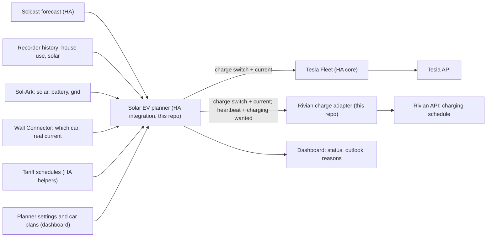

# Working plan: smart solar charging for the Tesla and the Rivian

Last updated: October 25, 2026. This is the plan we work from. Earlier designs and research notes are in git history.

**Where things stand:** the Rivian adapter, the planner integration and the real-data test tools are built and tested against fakes only. Nothing has run against the real cars, charger or Home Assistant yet. The next step is the owner's: [TESTING.md](TESTING.md) walks through phases 1 to 6, and [Open items](#open-items) lists what remains.

## Goal

**The main purpose: plug a car in during the day and it charges from excess solar, with as little paid grid power as possible.** The home battery absorbs the swings. A car plugged in overnight charges in the free hours by default. Charging should change gradually and predictably, not chase every cloud. It must be easy to see what is happening and to steer it from one Home Assistant dashboard.

## What we use

Only the hardware already in place:

| Piece | Role | How Home Assistant talks to it |
| --- | --- | --- |
| Home Assistant OS (Proxmox VM) | Runs everything below; already has real-time solar data, history and the Solcast forecast | — |
| Sol-Ark inverter and home battery (about 31 kWh usable) | Solar, house and battery measurements | Existing Sol-Ark integration |
| Tesla Wall Connector Gen 3 | **Measurement only**: power, current, whether a car is connected. Tesla publishes no way to set its current. | HA core Tesla Wall Connector integration (local) |
| Tesla | Charging on/off and current | Tesla's own API, through HA core **Tesla Fleet** |
| Rivian R1S (2025, Gen 2) | Charging current and pause, through its charging schedule | Rivian's API: upstream [`home-assistant-rivian`](https://github.com/bretterer/home-assistant-rivian) for data, this repo's [Rivian charge adapter](RIVIAN_CHARGE_ADAPTER.md) for control |

Only one car can be on the Wall Connector at a time, so only one car charges at a time.

## Decisions

Made:

1. **No new hardware.** Everything goes through the existing stack and the cars' and charger's APIs.
2. **Tesla through Tesla's API.** HA core Tesla Fleet, with the owner's own Tesla developer account. No Teslemetry, no Bluetooth hardware.
3. **Rivian through Rivian's API.** A Gen 2 has no remote start/stop or set-current command (those need a phone key that Gen 2 does not support yet). Its charging schedule is the only lever, and the adapter writes it. Other owners already solar-charge an R1S this way ([`rchav/rivian_solar_charge_ha`](https://github.com/rchav/rivian_solar_charge_ha)); nobody has published that it works on a Gen 2, so an attended trial confirms it for this car.
4. **The Wall Connector measures, the cars act.** Its readings are the ground truth for what the car really draws.
5. **A forecast-predictive planner decides the current**, not a reactive surplus follower (see [The planner](#the-planner)). It plans smooth currents from the forecast and recent usage, and lets the home battery absorb short-term swings.
6. **Electricity plans are configurable.** Today's plan has free hours from 8 PM to 6 AM, and that will change; time of use, flat and buyback plans must also work by changing settings, not code.
7. **One dashboard in Home Assistant** with built-in cards, plus the planner's settings.
8. **The planner controls the cars directly; evcc is not used** (October 25, 2026). evcc's core is a loop that follows the surplus every 30 seconds, which is what decision 5 replaces, and night charging in free hours is simple to do in the planner. Keeping evcc as a pass-through would leave two systems competing for the same controls. **Reversible:** the evcc config and glue package are in commit [`266b3bf`](https://github.com/bballdavis/HASS-Solar-Rivian/tree/266b3bf0f022fcccbcf3874c6511963aac61d711/config), and the Rivian adapter exposes the same switch and current number evcc would use, so bringing evcc back means installing the add-on and restoring one file.
9. **Plugging in by day starts solar charging; overnight is the default otherwise.** A car plugged in during the day charges from excess solar automatically. A car on the charger at night charges in the free hours, by default from 10 PM to 6 AM; both times are settings.
10. **The energy-budget planner** (October 25, 2026). Of three designs simulated against an evcc-like follower, the one that sets one steady current from the predicted battery path was chosen: it is as good as the best on the owner's tariff, holds up on plans, and is the simplest to explain ([PLANNER_DESIGN.md](PLANNER_DESIGN.md)).
11. **Shadow mode first.** The planner installs in shadow mode and sends nothing until the owner turns it off; the Rivian adapter installs in dry run.
12. **Paid power only for plans.** Without a plan, the planner never chooses paid power. A plan's remainder that sun, battery and free hours cannot cover is charged from paid hours.
13. **One repository, two integrations.** HACS installs one integration per repository, so it installs the adapter, and the planner is copied by hand ([PLANNER.md, install](PLANNER.md#install)).

## How it works

## The planner

A Home Assistant integration in this repo ([PLANNER.md](PLANNER.md): install, configuration, entities), with two modes chosen by when the car is on the charger. A minute-by-minute safety check runs in both but acts only when something is wrong.

**Daytime solar charging (the main purpose).** Plugging a car in during the day starts it automatically, with no app or button. The goal is to put excess solar into the car while keeping paid grid import as low as possible. Every 15 minutes the planner plans the car's current as described below. If the car is still below its target when the free hours begin, night charging takes over.

**Night charging (the default overnight).** In the charging window (default 10 PM to 6 AM, inside the free hours), the car on the charger charges at its full current until it reaches its plan target or its charge limit, then stops. If the window alone cannot deliver what is needed, charging starts earlier in the free hours, as late as possible. If sun, battery and free hours together cannot deliver a plan's target by its time, the car's outlook says so, and the remainder is charged from paid hours: at once when the deadline falls inside today's solar window, otherwise in the cheapest paid hours as late as possible. The home battery should not feed the car at night; see [Information needed](#information-needed).

Daytime solar charging works like this:

**Inputs:** the Solcast forecast for today and tomorrow (half-hour slots with pessimistic, typical and optimistic values), actual solar and house use so far today, recent house use from the recorder (the last 14 days, weighted toward the most recent, weekdays and weekends kept apart), battery level, which car is plugged in with its level, limit and plan, and the tariff schedule.

**Nothing seasonal is fixed.** Day length, expected solar, house demand and the reserve the battery needs all come from the current forecast and recent use every time the planner runs. The same settings therefore behave sensibly in June and in December: a short winter day or a summer evening with air conditioning simply leaves less for the car.

**How it decides:**

1. **Forecast as a range, corrected by today.** Each half-hour of the forecast is a bell curve (most likely value and spread). Today's actual production so far updates the rest of the day: in the morning the forecast dominates, by afternoon today's real behaviour does, and the uncertainty shrinks.
2. **Predict the battery, not just the moment.** Using that forecast and the house's usual demand, it predicts the battery level from now through the evening and night until the next refill (sunrise or free hours).
3. **The floor is a limit on the prediction.** If the predicted lowest battery level stays above the floor at the chosen confidence, draining the battery now is fine: the car keeps a steady current and the battery covers clouds. The planner changes the car's current only when the prediction says the floor, or paid grid power, is at risk.
4. **Excess solar first, paid grid last.** By day the car takes the solar the house and the battery's predicted needs do not, plus battery energy within the floor rule. Paid grid power is used only when a plan cannot be met by solar, the battery and the next free hours.
5. **Smooth current.** The car's share follows the shape of the forecast across the day, as a gentle rise and fall in amps. Changes are rate-limited (at most one every 15 minutes by default, a few amps at a time, small differences ignored). That also keeps Rivian schedule writes and billed Tesla commands to a few per hour.

**Safety rules that override the plan** (checked every minute):

- battery at the floor: reduce or pause the car;
- paid grid import for longer than the tolerance: reduce or pause;
- battery full and exporting for a while: allow an early increase;
- car unplugged, away, at its limit, or its data stale: stop commanding it;
- planner off or unable to plan: its heartbeat goes unavailable, and the Rivian adapter parks the Rivian's charging window after 3 minutes; the Tesla keeps its last current up to its own charge limit;
- Home Assistant down: the Rivian's charging window lapses on its own within about 25 minutes (adapter behaviour); the Tesla keeps its last current up to its own charge limit.

**Settings** (entities of the planner, listed in [PLANNER.md](PLANNER.md#settings); the defaults held up in the simulation):

| Setting | Default | Meaning |
| --- | --- | --- |
| Planner | on | Off: no plans, nothing sent. The Tesla keeps its last current; the Rivian adapter parks the Rivian within minutes. |
| Shadow mode | on | Plan and explain, send nothing. Turned off by the owner in phases 4 and 6. |
| Free hours | 8 PM–6 AM daily | A Schedule helper; repaint it when the plan changes |
| Price outside free hours | $0.32/kWh | Used to weigh paid grid power against other choices |
| Solar buyback | $0.00/kWh | What exported solar earns |
| Night charging window | 10 PM–6 AM | When the overnight car charges |
| Night charging current | the car's maximum | Lower it to spread the charge over the night |
| Daytime solar charging | on | On: plugging in by day starts solar charging. Off: a car plugged in by day waits for the night window |
| Caution | conservative | How much of the forecast to count on, from "near-certain" to "typical day" |
| Battery floor | 30% | The predicted battery level must stay above this |
| Battery level wanted when free hours start | 40% | What the battery should still hold for the paid evening; with no free hours, at sunset |
| Minimum time between current changes | 15 min | |
| Largest single change | 6 A | |
| Paid grid tolerance | 5 min | How long paid import is accepted before the safety rule acts |
| Per car: charge limit | car's own | |
| Per car: plan | none | "X% by time T", once or on weekdays, every day or weekends |

The algorithm, its tuning and the simulation results are in [PLANNER_DESIGN.md](PLANNER_DESIGN.md). On the owner's tariff over 453 simulated days, it cut car-caused paid import from 179 kWh (an evcc-like follower) to 2.6 kWh, and current changes from 29 a day to 3.7; every simulated plan was met.

## Electricity plans

Each plan is described with Home Assistant's **Schedule** helper, a weekly calendar where you paint the hours:

- the free hours as one schedule, at $0;
- each other price level (for example "Peak") as a **price window**: its own schedule and a price entity;
- a normal price for all other hours (default $0.32/kWh);
- a solar buyback rate.

When the plan changes, repaint the schedules in the HA UI. A real-time-price plan could later use a price sensor instead. [PLANNER.md](PLANNER.md#electricity-plans) shows how free nights, time of use, flat and free weekends are set up.

With **free nights**, a car plugged in by day takes the solar left after the house and what the battery needs to carry the house until the free hours begin. That reserve is worked out each time from the forecast and recent evening use, so it grows on short or cloudy days and shrinks on long sunny ones. A car on the charger overnight charges in the free hours. With one charger, only the overnight car gets the free hours; the dashboard shows which car should be plugged in tonight.

## Dashboard

One view, built-in cards only. A starting dashboard is in [PLANNER.md](PLANNER.md#a-starting-dashboard); a finished one is an [open item](#open-items).

- **Now:** sun, house, battery (level and flow), grid, charger power; forecast left today and tomorrow.
- **On the charger:** which car, its level and limit, current and the next planned change, with the planner's reason in one sentence.
- **Each car:** level, limit, plan and its outlook ("covered by sun", "≈ 7 kWh in free hours", "≈ 3 kWh paid").
- **Battery outlook:** predicted level through tonight against the floor.
- **Settings:** the planner settings above and the tariff schedules.

## Phases

Each phase ends with a check that must pass before the next. [TESTING.md](TESTING.md) gives the steps for phases 1 to 6.

| Phase | Work | Done when | Status |
| --- | --- | --- | --- |
| 0. Prerequisites | Owner provides the [missing details](#information-needed). Register a Tesla developer app; host Tesla's public key on a domain you control (a free static site works). | All details recorded in this plan. | Open (owner) |
| 1. Read everything | Add Tesla Fleet (approve the virtual key in the car). Install the Rivian adapter in dry run. Confirm Wall Connector, Sol-Ark, Solcast and both cars read correctly for a week, including which car is on the charger. | Every planner input is present and fresh; no control yet. | Ready: `tools/check.py` and `tools/snapshot.py` are built |
| 2. Planner design | Finish the simulation, pick the design, write `PLANNER_DESIGN.md`. | Owner agrees with the behaviour on the simulated days. | Design **done** ([PLANNER_DESIGN.md](PLANNER_DESIGN.md)); the owner's agreement is open, and `tools/replay.py` shows the behaviour on real days |
| 3. Build the planner | HA integration with tests: night charging first, then daytime solar charging; tariff schedules; dashboard. Runs in **shadow mode**: it plans and explains, but sends nothing. | A week of shadow plans that the owner finds sensible. | **Built** and tested against fakes; starting dashboard only. Owner's shadow week to do. |
| 4. Tesla under the planner | Let the planner command the Tesla. | A week with no unexpected paid import, few changes per day, plans met, and the Wall Connector confirming each change. | Ready: `tools/attended_test.py tesla` first |
| 5. Rivian trial | Attended trial with the adapter ([steps](RIVIAN_CHARGE_ADAPTER.md#attended-trial)): current changes, pause, lapse, exact restore of the owner's schedule. | The car follows schedule changes reliably. If it does not, decide between Rivian on a fixed schedule only or a controllable charger. | Ready: `tools/attended_test.py rivian` |
| 6. Rivian under the planner | Let the planner command the Rivian through the adapter. | Same checks as phase 4, plus the owner's own Rivian schedule restored on unplug. | Ready after phase 5 |
| 7. Unattended | Notifications for faults and safety-rule trips; review a month of results. | A month without manual intervention. | Not started |

## Repository changes

Done:

- [x] **Kept** the Rivian charge adapter. It takes a charge switch and a current number from any controller and writes the Rivian schedule safely.
- [x] **Adapted the adapter to the planner:**
  - its liveness and charging options are now `controller_liveness_entity` and `controller_charging_entity`, pointed at the planner's heartbeat and the car's charging-wanted sensor; the `evcc_*` options and the evcc status sensor were renamed, with a migration that keeps the sensor's history;
  - the two evcc-era current rules (the 3 A increase margin and the hold just below 48 A) are options, off by default.
- [x] **Added the planner integration** (`custom_components/solar_ev_planner`): the core from the design, the config flow with the owner's entities as suggestions, cars and price windows as subentries, the settings as entities, shadow mode, the executor, and the heartbeat and charging-wanted entities for the adapter ([PLANNER.md](PLANNER.md)).
- [x] **Moved the glue's useful logic into the planner:** which car is on the Wall Connector, the vehicle override, the Tesla current restore at unplug, and the stale-input check.
- [x] **Tariff helpers:** the free hours and every price level are Schedule helpers; prices are entities.
- [x] **Added `PLANNER_DESIGN.md`**, and [TESTING.md](TESTING.md) for the real-data path.
- [x] **Added real-data tools** (`tools/`): a read-only check, sanitized snapshots and a forecast recorder, a replay of the planner over real days, and the attended Tesla test and Rivian trial ([tools guide](../tools/README.md)).
- [x] **Tests:** the adapter, the planner (including both integrations running together) and the tools, against fakes only.

Retired:

- **evcc** config and the HA glue package (removed; last versions in [`266b3bf`](https://github.com/bballdavis/HASS-Solar-Rivian/tree/266b3bf0f022fcccbcf3874c6511963aac61d711/config)).
- **Removed from the tree:** the earlier architecture record, roadmap, ecosystem survey, research brief, source index, discussion history and the `reference/` snapshots of the earlier prototype. They remain in git history, last present in commit [`4f9120a`](https://github.com/bballdavis/HASS-Solar-Rivian/tree/4f9120adf605f1fe21ce295b0fd4972bb838dd4d).

## Open items

- [ ] **The owner's test path,** phases 0 to 6 ([TESTING.md](TESTING.md)), starting with the [information needed](#information-needed).
- [ ] **Start recording Solcast forecasts now** (`python -m tools.snapshot record-forecasts` on an always-on machine). Home Assistant does not keep Solcast's half hours, so replays of past days use an approximation until it has run for a while.
- [ ] **A finished dashboard.** [PLANNER.md](PLANNER.md#a-starting-dashboard) has a starting one with built-in cards; the battery outlook as a chart and the per-car outlook still need a layout.
- [ ] **Recalibrate the caution level** from the shadow week: in simulation the 90% battery path held only 76% of the time ([PLANNER_DESIGN.md](PLANNER_DESIGN.md#11-known-limits)).
- [ ] **Confirm what Planning off should mean.** Today it sends nothing: the Tesla keeps its last current, and the Rivian adapter, seeing the heartbeat down, parks the Rivian within minutes. Going back to shadow mode also sends nothing, so both cars keep their last command until they are paused or unplugged ([PLANNER.md](PLANNER.md#planning-off-and-shadow-mode)).
- [ ] **Phase 7:** notifications for adapter faults, safety-rule trips and the planner not planning.
- [ ] **Installing through HACS** gives only the adapter. Moving the planner into its own repository would make it installable through HACS too; until then it is copied by hand.
- [ ] **Small known limits:** the executor's hourly command count resets on restart; the planner needs the Wall Connector power sensor to plan; real Tesla Fleet timing, Solcast attribute types and the Sol-Ark's reporting cadence are unchecked until phases 1 and 3.

## Information needed

1. **The home battery at night.** Is the Sol-Ark set to hold the battery during free hours, so the house and the charging car run from the grid? If not, a car charging at 11 kW overnight drains the home battery, which then cannot cover the paid morning before the sun. This is an inverter setting (time-of-use slots); it may be adjustable from Home Assistant. The planner's "battery holds during free hours" option (on by default) must match it.
2. **The Sol-Ark's battery limits:** its maximum charge and discharge power and the level where it stops discharging. The planner assumes 9 kW, 9 kW and 10%; all three are options.
3. **When each car usually needs to be charged by, and which car is usually plugged in overnight.** These become the per-car plans.
4. **The Tesla's model and year, and its maximum current on the Wall Connector** (32 or 48 A). The planner also reads the car's own maximum from Tesla Fleet's current number.
5. **A domain you control,** for Tesla's public key.
6. **The Rivian charger state sensor's entity ID,** for the adapter's optional `charger_state_entity` (the Rivian integration's charger state sensor). Without it the adapter's charger status never shows charging.
7. **An always-on machine for the forecast recorder** (any computer that reaches Home Assistant; [tools guide](../tools/README.md#snapshotpy-real-days-as-a-file)).

Answered: free hours are 8 PM–6 AM for now; the price outside them is $0.32/kWh; solar buyback is $0.00/kWh; cars charge at night from 10 PM. All of them are settings. Plugging in by day starts solar charging, the app's main purpose. evcc is removed (decision 8). The owner's entity IDs for the Sol-Ark, the Wall Connector, Solcast, the Rivian and the Rivian adapter are known; the Tesla's Tesla Fleet IDs are expected as `switch.roxxo_charge`, `number.roxxo_charge_current` and so on, and `tools/check.py` confirms them in phase 1.

## Risks and unknowns

- **Gen 2 Rivian behaviour** is unconfirmed until the phase 5 trial.
- **Forecast quality** on fast-changing days: the planner leans on the battery and the safety rules there.
- **Tesla API cost and limits:** a few commands an hour stays within Tesla's monthly credit; verify on Tesla's developer dashboard in phase 4.
- **Internet down:** both cars' APIs are cloud services, so neither can be commanded. The Rivian's window lapses on its own; the Tesla keeps charging at its last current up to its limit.
- **The home battery feeding the car at night,** if the Sol-Ark is not set to hold it during free hours (information needed, item 1).
- **The caution level is optimistic** until it is recalibrated from shadow-mode data; the safety rules and re-planning every 15 minutes cover the gap in simulation.
- **Nothing has run against the real system.** Every test so far uses fakes; the phases above are where the real behaviour is checked.
