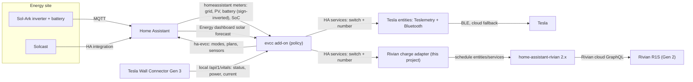

# Solar charging architecture: evcc as the brain, thin vehicle adapters

Status: **proposed decision**, October 24, 2026. This record changes part of the earlier direction in the [research brief](RIVIAN_SOLAR_CHARGING_RESEARCH_AND_HARNESS_BRIEF.md#decisions-and-ownership); see [Consequences](#consequences-for-earlier-decisions). The evidence is in the [ecosystem survey](ECOSYSTEM_SURVEY.md) and the work plan is in the [roadmap](ROADMAP.md). Nothing in this record was tested against the live vehicles, charger, or Home Assistant instance. Upstream claims cite source at pinned commits; vehicle behavior claims are labeled by evidence strength.

## Decision

Use **[evcc](https://github.com/evcc-io/evcc)**, run as the Home Assistant add-on, as the single solar-charging policy engine for both vehicles.

1. **evcc decides; vehicles act.** evcc reads the Sol-Ark through Home Assistant and polls the Tesla Wall Connector Gen 3 (TWC3) directly. The TWC3 cannot be commanded, so evcc's `twc3` charger forwards start/stop and current to whichever vehicle is plugged in.
2. **Each car is an ordinary set of HA entities.** Each vehicle is configured as an evcc `homeassistant` vehicle. That vehicle type maps an HA `switch` or `script` pair to start/stop and an HA `number` to the charge current.
3. **Tesla: existing integration.** Its entities come from an existing integration. The preferred one is HA core Teslemetry with the local Bluetooth vehicle sub-entry.
4. **Rivian: upstream entities plus one adapter.** Its entities come from upstream [`bretterer/home-assistant-rivian`](https://github.com/bretterer/home-assistant-rivian) 2.x plus one small **Rivian charge adapter**. That adapter is the only control code this project should own.
5. **Hardware fallback.** An attended trial may show that a Gen 2 R1S does not reliably follow charging-schedule changes. In that case, replace the TWC3 with a locally controllable NACS EVSE; OpenEVSE is the reference choice. evcc then controls both cars at the charger, and the vehicle adapters become read-only.

## Why this shape

The constraint that decides everything: **the installed TWC3 has no writable interface.** Every control path is therefore either the vehicle's own API or a different EVSE.

- **evcc already handles this case, and the code is generic.** evcc's `twc3` driver does not check the vehicle make. `Enable` calls the active vehicle's `ChargeController` and `MaxCurrent` calls its `CurrentController` ([`charger/twc3.go#L105-L151`](https://github.com/evcc-io/evcc/blob/bf5c276cdb395443fda4601b99151c0a962d0db4/charger/twc3.go#L105-L151)). Only the template text limits support to Teslas ([`twc3.yaml#L9`](https://github.com/evcc-io/evcc/blob/bf5c276cdb395443fda4601b99151c0a962d0db4/templates/definition/charger/twc3.yaml#L9)).
- **Any HA-controllable car can be an evcc vehicle.** The `homeassistant` vehicle accepts these and implements those interfaces ([`vehicle/homeassistant.go#L42-L116`](https://github.com/evcc-io/evcc/blob/bf5c276cdb395443fda4601b99151c0a962d0db4/vehicle/homeassistant.go#L42-L116)):
  - `start_charging`/`stop_charging` as a `switch.*` or a pair of `script.*`;
  - `setMaxCurrent` as a `number.*` or `input_number.*`.
- **No evcc sponsorship token is required** for `twc3`, `tesla`, `tesla-ble`, `openevse`, or any `homeassistant` device. See the [survey](ECOSYSTEM_SURVEY.md#evcc).
- **evcc covers what the prototype re-implemented:**
  - surplus calculation;
  - enable/disable delays;
  - current stepping;
  - home-battery priority and buffer (`prioritySoc`, `bufferSoc`, `bufferStartSoc`);
  - per-vehicle minimum and maximum current, mode and SoC plans;
  - a UI;
  - a maintained HA integration ([`marq24/ha-evcc`](https://github.com/marq24/ha-evcc)) for modes, plans, and sensors.

  Rebuilding and maintaining that is the wheel the owner asked not to reinvent.
- **Nobody solves Gen 2 Rivian actuation.** evcc has no Rivian support. Upstream Rivian start/stop needs a phone key that Gen 2 cannot pair yet. This project's effort belongs there.

## Architecture

| Layer | Choice | Reason | Held in reserve |
| --- | --- | --- | --- |
| Policy engine | evcc add-on (0.316+ "smart" mode) with `ha-evcc` | Mature solar loop, battery buffer, per-vehicle settings, plans, UI; sponsor-free for this setup | [`flashg1/SolarCharger`](https://github.com/flashg1/SolarCharger) (HA-native, supports generic HA chargers) |
| Site meters | evcc `homeassistant` meter template over the existing Sol-Ark HA entities | No native Sol-Ark template exists; HA already has the data. A leading `-` inverts the battery sign. | Direct Modbus only if HA latency proves inadequate |
| Charger telemetry | evcc `twc3` charger polling the TWC3 locally | Independent of the HA `tesla_wall_connector` integration, which showed timeouts and stale values | HA sensors remain for dashboards and diagnosis |
| Solar forecast | evcc `homeassistant` solar tariff, which reads the HA Energy-dashboard forecast (Solcast) | No extra Solcast API calls. Display-only in free evcc; only the sponsor optimizer uses it for decisions. | evcc optimizer later, if wanted |
| Tesla actuation | HA core **Teslemetry** with the Bluetooth vehicle sub-entry, via an ESPHome Bluetooth proxy | Local commands at no per-command cost, per-command cloud fallback, streamed charge data | `esphome-tesla-ble` or `tesla_fleet`; evcc `tesla-ble` with TeslaBleHttpProxy |
| Rivian actuation | Upstream Rivian 2.x schedule entities plus the Rivian charge adapter, **gated on an attended trial** | Only software lever on a Gen 2 car is the charging schedule | Replace the TWC3 with OpenEVSE (NACS) |
| Vehicle identification | HA template status sensors that report `a` unless the car is home and plugged into the TWC3; **no default vehicle** in evcc | evcc detection uses status only, not location | Manual assignment through the `ha-evcc` select |
| UI | evcc UI (ingress) plus `ha-evcc` entities on an HA dashboard | Already built and maintained | Prototype panel kept only as reference |

## What this project builds, reuses, and retires

- **Build (small):**
  - **The Rivian charge adapter.** Contract below.
  - **An HA "glue" package.** It holds the status sensors for evcc vehicle detection, a write debouncer for the Rivian, and a safety watchdog.
  - **Commissioning protocols and evidence notes.**
  - **Optional upstream contributions:** full-list schedule services for `home-assistant-rivian`, and fixes found during the trial.
- **Reuse:** evcc, `ha-evcc`, HA core Teslemetry/ESPHome, upstream `home-assistant-rivian` and `rivian-python-client`, and the existing Sol-Ark and Solcast integrations.
- **Retire:**
  - the prototype `solar_ev_charging` engine, coordinator, and panel;
  - the combined Rivian fork (move back to upstream 2.x);
  - `tesla_custom`, once Teslemetry is commissioned.

  The [`reference/`](../reference/) snapshot stays as history.
- **Port from the prototype into the adapter:** schedule normalization and canonical hashing ([`schedule.py`](../reference/ha-prototype-source/custom_components/rivian/schedule.py)), the journaled ownership/restore discipline, and the relevant fixtures and tests.

## Vehicle control models

### Tesla

- **evcc vehicle:** `homeassistant` template, with `phases: 1`.
  - `start_charging`: the Teslemetry charge `switch`;
  - `setMaxCurrent`: the charge-current `number`;
  - `soc` and `limitSoc` from Teslemetry;
  - `status` from the glue package's location-aware sensor.
- **Current floor:** 6 A. Two independent codebases resend commands that cross 5 A, and the car's base load makes 1–4 A inefficient. Amps change live without restarting the session.
- **Physical feedback:** evcc measures charging through the TWC3, independently of the car's command acknowledgement.
- **Failure mode:** if evcc or HA stops mid-session, the Tesla keeps charging at the last current until its own charge limit.
  - The glue watchdog should stop the car when evcc is unavailable.
  - The Tesla's charge limit is the final backstop.
  - The Tesla remembers the last current, so restore a normal amperage at session end. Otherwise a later manual charge starts at 6 A.
- **Cost:** Bluetooth commands are free. Cloud fallback uses Teslemetry credits; see the [survey cost model](ECOSYSTEM_SURVEY.md#tesla).

### Rivian (Gen 2 R1S)

| Fact | Evidence |
| --- | --- |
| No usable start/stop. Upstream `charging_enabled` (`START_CHARGING`/`STOP_CHARGING`) is created only for vehicles with a paired phone key, and the README says Gen 2 pairing is not supported yet. | [`switch.py#L34-L50`](https://github.com/bretterer/home-assistant-rivian/blob/088fd22cb0a82c9c8752c5b8e483096738166891/custom_components/rivian/switch.py#L34-L50), [`switch.py#L90-L99`](https://github.com/bretterer/home-assistant-rivian/blob/088fd22cb0a82c9c8752c5b8e483096738166891/custom_components/rivian/switch.py#L90-L99), [`README.md#L61`](https://github.com/bretterer/home-assistant-rivian/blob/088fd22cb0a82c9c8752c5b8e483096738166891/README.md#L61) (code, high) |
| Upstream 2.x creates schedule controls for **every** vehicle, with no phone-key gate: `number.*_charging_schedule_amperage` (8–48 A, step 2), `switch.*_charging_schedule_enabled`, and schedule start/end `time` entities. | [`number.py#L46-L80`](https://github.com/bretterer/home-assistant-rivian/blob/088fd22cb0a82c9c8752c5b8e483096738166891/custom_components/rivian/number.py#L46-L80), [`switch.py#L76-L106`](https://github.com/bretterer/home-assistant-rivian/blob/088fd22cb0a82c9c8752c5b8e483096738166891/custom_components/rivian/switch.py#L76-L106), [`const.py#L1476-L1478`](https://github.com/bretterer/home-assistant-rivian/blob/088fd22cb0a82c9c8752c5b8e483096738166891/custom_components/rivian/const.py#L1476-L1478) (code, high). The README table still lists them under phone-key controls; code wins for entity creation. |
| Upstream's schedule write sends **only the first schedule** in `setChargingSchedules` but keeps the others in its local cache. If the mutation replaces the full list, which its name suggests, a car with several schedules could lose the rest. | [`coordinator.py#L415-L453`](https://github.com/bretterer/home-assistant-rivian/blob/088fd22cb0a82c9c8752c5b8e483096738166891/custom_components/rivian/coordinator.py#L415-L453) (code, high; server semantics unverified) |
| Turning a schedule off (`enabled: false`) does **not** pause charging; with no active schedule the car charges at full power. The working "pause" keeps the schedule enabled and moves its window away from now. | [rchav `rivian_client.py#L236-L248`](https://github.com/rchav/rivian_solar_charge_ha/blob/0c4e6ec9d48a576e9a8dcdf2f6ac775867af433b/custom_components/rivian_solar_charging/rivian_client.py#L236-L248) (author's documented observation, medium) |
| Changing the schedule amperage in the Rivian app takes effect mid-charge at home. | Owner report in [upstream issue #244](https://github.com/bretterer/home-assistant-rivian/issues/244); vehicle generation not stated (medium/low) |
| Parallax vehicle operations (`send_vehicle_operation`) do not need an enrolled phone. The client decodes the charging RVMs `charging.session.soc_slider` (charge limit) and `charging.schedule.time_window` (window and amps). Nothing shows that writes to those charging RVMs are honored. | [`rivian.py#L765-L807`](https://github.com/bretterer/rivian-python-client/blob/67ba96fc16bc810b88f9ddf86fcf5955a494d5b0/src/rivian/rivian.py#L765-L807) (code, high); charging writes are a research lead only |

**Adapter contract.** These are the entities evcc's `homeassistant` vehicle consumes:

| Entity | Behavior |
| --- | --- |
| `switch.rivian_solar_charging` | **On:** take ownership and write a short charging **lease** whose window covers now, at the requested amperage; renew it while on. **Off:** release ownership. If the provider still holds the adapter's last write, restore the owner's snapshotted schedule list exactly. Otherwise refuse and raise a fault. |
| `number.rivian_solar_current` (8–48 A, step 2) | Rewrite the lease amperage. Round down to an even number, apply a ≥2 A deadband and a minimum write interval, and never write while ownership is unclear. |
| `sensor.rivian_evcc_status` (`a`/`b`/`c`) | `a` unless home, plugged into the TWC3 and connected. `c` when `chargerState` is active, else `b`. |
| Diagnostics | Ownership journal phase, owned hash, last write and readback, lease expiry, last error, rate-limit state. |

**Why a short lease rather than an all-day window.**

- **The all-day window used by `rchav`** fails open. If the controller dies while charging, the car keeps charging at the last amperage until its own limit.
- **A short lease** (proposed: 15 minutes, renewed every 5) lapses on controller loss. If the trial confirms that a window ending mid-session stops charging, the failure stops the car within one lease. The residual is a weekly recurrence of that short window until the schedule is restored on recovery.

  The prototype used this lease pattern with a 10-minute window ([prototype `coordinator.py#L687-L714`](../reference/ha-prototype-source/custom_components/rivian/solar_ev_charging/coordinator.py#L687-L714)).

**Gate before building the adapter.** This is an attended trial against the live car; see [roadmap phase 3](ROADMAP.md#phase-3--rivian-attended-control-trial). Each claim below holds only once the trial measures it.

- A schedule amperage change applies mid-session, within a measured latency.
- Moving the window off "now" stops a session.
- An expiring lease stops a session.
- Moving the window back onto "now" starts one.
- An exact restore succeeds.

If amperage works but stop/start does not, evcc can still run the Rivian with "always charge" at modulated current while the owner starts sessions manually. If neither works reliably, use the hardware path.

## Hardware decision point

Choose a controllable EVSE when any of these is true:

- the Rivian trial fails T3/T4;
- Rivian latency is measured in minutes;
- the owner wants solar charging that keeps working when a vehicle cloud is down.

| Option | What it gives | Evidence |
| --- | --- | --- |
| **OpenEVSE Advanced 48 A, NACS** (store listing: about $599 kit, about $679 assembled, October 2026) | **Charger-side current and pause for both cars**: no vehicle API needed for control, so local operation survives internet loss. Supported by an HA core integration (charge-rate `number`, override `select`, built-in solar divert `switch`) and by the sponsor-free evcc `openevse` template. With a NACS cable the Rivian needs a NACS-to-J1772 AC adapter, probably what it uses on the TWC3 today (open question 5). A J1772-cabled unit would put the adapter on the Tesla instead. | [HA core `openevse`](https://github.com/home-assistant/core/tree/3902d41667731e9a2cb911d73b023b859ba5b299/homeassistant/components/openevse), [evcc `openevse.yaml`](https://github.com/evcc-io/evcc/blob/bf5c276cdb395443fda4601b99151c0a962d0db4/templates/definition/charger/openevse.yaml), [OpenEVSE store](https://store.openevse.com/products/advanced-series-48a-level-2-nacs-kit-bundle) |
| OCPP charger (e.g. Grizzl-E) | Same control quality | evcc's generic and Grizzl-E OCPP templates require a sponsor token: $4/month or about $150 lifetime ([`ocpp.yaml#L50`](https://github.com/evcc-io/evcc/blob/bf5c276cdb395443fda4601b99151c0a962d0db4/templates/definition/charger/ocpp.yaml#L50)) |
| TWC3 meter emulation ([`tesla-loadpilot`](https://github.com/zany92/tesla-loadpilot), [`esphome-twc-control`](https://github.com/PVi1/esphome-twc-control)) | Charger-side control without replacing the TWC3 | **Not recommended here.** It is validated on one French three-phase site, and its own README calls single-phase support "theoretical". The charger can distrust the emulated meter "sometimes for hours". Losing the meter falls back to a 6 A cap, not zero. It needs RS485 wiring inside the TWC3 and an installer-menu workaround. ([README#L11](https://github.com/zany92/tesla-loadpilot/blob/5e83b936d055fa0ff375052f4592a28731dd6cb2/README.md#L11), [#L57](https://github.com/zany92/tesla-loadpilot/blob/5e83b936d055fa0ff375052f4592a28731dd6cb2/README.md#L57), [#L167](https://github.com/zany92/tesla-loadpilot/blob/5e83b936d055fa0ff375052f4592a28731dd6cb2/README.md#L167), [#L194](https://github.com/zany92/tesla-loadpilot/blob/5e83b936d055fa0ff375052f4592a28731dd6cb2/README.md#L194)) |

The EVSE swap is the single biggest lever toward "flawless for both". The software path is recommended first because it costs nothing, makes the Tesla work immediately, and answers the Rivian question with a single afternoon trial.

## evcc pitfalls to configure around

| Pitfall | Effect | Mitigation | Source |
| --- | --- | --- | --- |
| A charger that does not report phases defaults to **3 phases** | evcc would demand about 4.1 kW before starting, roughly the whole typical export | Set loadpoint phases to 1 in the UI and `phases: 1` on both vehicles | [`core/loadpoint.go#L315-L324`](https://github.com/evcc-io/evcc/blob/bf5c276cdb395443fda4601b99151c0a962d0db4/core/loadpoint.go#L315-L324) |
| Loadpoint `minCurrent`/`maxCurrent`/`phases` in YAML are **ignored** | Settings silently not applied | Set them in the evcc UI, REST, or `ha-evcc` | [`core/loadpoint.go#L114-L118`](https://github.com/evcc-io/evcc/blob/bf5c276cdb395443fda4601b99151c0a962d0db4/core/loadpoint.go#L114-L118) |
| Fixed **230 V** nominal voltage | About 4% model error on a 240 V service, causing about 1 A dithering | `residualPower` of 100–200 W; the loop self-corrects from the grid meter | [`util/grid/grid.go#L10`](https://github.com/evcc-io/evcc/blob/bf5c276cdb395443fda4601b99151c0a962d0db4/util/grid/grid.go#L10) |
| `prioritySoc` defaults to 0 in code | The car outranks the house battery from the start | Set `prioritySoc`, `bufferSoc`, `bufferStartSoc` explicitly | [`core/site.go#L1193-L1240`](https://github.com/evcc-io/evcc/blob/bf5c276cdb395443fda4601b99151c0a962d0db4/core/site.go#L1193-L1240) |
| Battery sign: evcc wants **+discharge**, Sol-Ark reports +charge | Surplus computed backwards | `power: -sensor.<battery_power>` in the meter template | [evcc docs](https://github.com/evcc-io/docs/blob/3a6a78295a35287ea9cbe4a12b035b58076c7f8b/src/content/docs/en/user-defined-devices.mdx?plain=1#L115-L125) |
| An `unavailable` meter entity keeps its **last value** | A stale grid reading cannot stop charging by itself | Glue watchdog sets evcc mode `off` and releases the Rivian lease when site inputs go stale | [`core/site.go#L1050-L1057`](https://github.com/evcc-io/evcc/blob/bf5c276cdb395443fda4601b99151c0a962d0db4/core/site.go#L1050-L1057) |
| Vehicle detection is **status-only**, and a pinned default vehicle disables it | evcc can command the wrong car (for example, stop the Tesla charging elsewhere) | Location- and TWC3-aware status sensors; no default vehicle | [`core/coordinator/coordinator.go#L132-L179`](https://github.com/evcc-io/evcc/blob/bf5c276cdb395443fda4601b99151c0a962d0db4/core/coordinator/coordinator.go#L132-L179) |
| Detection takes up to 10 minutes after plug-in, and a TWC3 car starts charging at plug-in | A short full-power burst before evcc identifies the car | Tesla: off-peak scheduled charging in the car. Rivian: its owner schedule already blocks off-window charging. | [`core/loadpoint_vehicle.go#L19-L22`](https://github.com/evcc-io/evcc/blob/bf5c276cdb395443fda4601b99151c0a962d0db4/core/loadpoint_vehicle.go#L19-L22) |
| Split-phase TWC3 current is `currentA + currentB` | If US firmware reports the full current on both legs, evcc sees double current and power | Compare HA `current_a`/`current_b` with `vehicle_current` during a charge before enabling control | [`charger/twc3.go#L191-L218`](https://github.com/evcc-io/evcc/blob/bf5c276cdb395443fda4601b99151c0a962d0db4/charger/twc3.go#L191-L218) |
| A current mismatch is re-sent every 30 s cycle | Rivian GraphQL write churn and rate limits | Adapter deadband and minimum write interval; longer enable/disable delays | [`core/loadpoint.go#L1028-L1055`](https://github.com/evcc-io/evcc/blob/bf5c276cdb395443fda4601b99151c0a962d0db4/core/loadpoint.go#L1028-L1055) |
| Modes renamed in 0.316 to `off`/`smart`/`now` | Automations written for `pv`/`minpv` break | Use the new names | [evcc 0.316 blog](https://github.com/evcc-io/docs/blob/3a6a78295a35287ea9cbe4a12b035b58076c7f8b/src/content/docs/en/blog/2026/09/25/highlights-smart-battery-solar-share.mdx) |

## Safety model

1. **One writer per actuator: evcc.** Disable every other automation that touches Tesla current or switch, and every other schedule writer: the prototype controller, the Rivian app's schedule edits during control, `rchav`-style integrations.
2. **Accepted is not physical.** Judge results by TWC3 measurements, never by a command response.
3. **The vehicle charge limit is the final backstop** for both cars.
4. **Persist ownership before side effects** (Rivian adapter). Never overwrite a schedule edit the adapter did not make.
5. **A watchdog covers evcc's gaps**: stale site meters, evcc unavailable, Rivian lease renewal failures.

| Failure | Tesla | Rivian (lease adapter, if the trial passes) | With OpenEVSE |
| --- | --- | --- | --- |
| evcc stops | Charges at last current to its limit unless the watchdog stops it | Lease lapses within 15 minutes; the car stops if T4 passes | EVSE holds its last claim; the watchdog can pause it locally |
| HA host down | Same as evcc (the add-on runs on HA) | Lease lapses | EVSE keeps its last state; OpenEVSE's own solar divert is a possible local fallback |
| Internet down | Bluetooth commands still work; no cloud fallback | Writes fail; the lease lapses | Unaffected |
| Rivian cloud or rate limit | n/a | Adapter faults; the lease lapses | Unaffected for control |

## Alternatives considered

| Alternative | Verdict |
| --- | --- |
| Continue the prototype's custom engine as the policy layer | **Rejected.** It duplicates evcc's surplus/battery/hysteresis/plans/UI and leaves this project maintaining a control loop. Its Rivian safety discipline is ported into the adapter. |
| [`flashg1/SolarCharger`](https://github.com/flashg1/SolarCharger) (HA integration, 0.13.4) | **Reserve.** HA-native, actively developed, has a `user_custom` charger for generic HA entities. Single maintainer, "work in progress", and a single net-power feedback loop with simpler battery handling than evcc. |
| [TeslaSolarCharger](https://github.com/pkuehnel/TeslaSolarCharger) | **Rejected.** Proprietary licence with paid activation. Controls non-Tesla cars only through an OCPP charger, so it cannot drive the Rivian on the TWC3. |
| [`rchav/rivian_solar_charge_ha`](https://github.com/rchav/rivian_solar_charge_ha) | **Ideas only.** Rivian-only. Replaces the whole schedule list with no restore. Its all-day charging window fails open. |
| TWC3 meter emulation | **Not recommended** for this US single-phase site (see the table above). |
| Tesla's "Charge on Solar" app feature | **Not available.** It requires a Powerwall, not a Sol-Ark. |
| EMHASS, Predbat, `solar_optimizer` | **Not evaluated in depth.** They optimize batteries or deferrable loads rather than run an EV loadpoint against a shared charger. Revisit only for multi-device optimization later. |

## Consequences for earlier decisions

- **Changed:** brief decision 2, "a separate future solar integration owns policy and UI".
  - **evcc** now owns the solar policy and primary charging UI.
  - **This project** owns the Rivian adapter, the HA glue configuration, and commissioning evidence.
  - **HA** still owns the automation surface and data, through `ha-evcc`.
- **Relaxed:** brief decision 4, "standalone CLI first". When the car has **exactly one** schedule, the attended Rivian trial can run through upstream 2.x entities in HA Developer Tools. The CLI harness remains the fallback for multiple schedules, or if the HA path is blocked.
- **Unchanged:**
  - decision 1: HA owns automation;
  - the no-private-`hass.data` rule: the adapter consumes only public HA entities and services;
  - decision 5: Gen 2 physical behavior is unproven, and a schedule window is not a guaranteed stop until measured.

## Open questions for the owner

1. **Hardware.** If the Rivian trial disappoints, is a roughly $600–700 EVSE swap (plus electrician) acceptable? Or should the Rivian stay on manual and schedule-only charging?
2. **Tesla.** What model and year is the Tesla (BLE phone-key support)? How far is its parking spot from the HA host? Can an ESPHome Bluetooth proxy go in the garage?
3. **`tesla_custom` proxy.** Does `tesla_custom` currently send commands through the unmaintained Tesla HTTP Proxy add-on?
4. **Rivian schedules.** How many charging schedules does the R1S have today, and what are they (off-peak window, location)?
5. **Rivian adapter.** Which NACS-to-J1772 adapter does the Rivian use on the TWC3? Does the TWC3 report it as connected?
6. **Tariff.** Is there a time-of-use tariff? evcc plans and night charging use it.
7. **Export limits.** Does the Sol-Ark ever curtail PV through an export limit? evcc only sees surplus that appears as export or battery charging.
