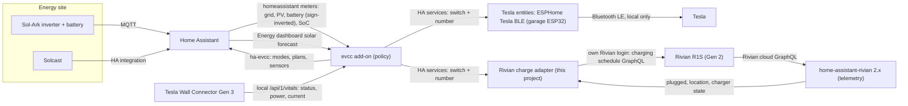

# Solar charging architecture: evcc as the brain, thin vehicle adapters

Status: **proposed decision**, October 24, 2026. This record changes part of the earlier direction in the [research brief](RIVIAN_SOLAR_CHARGING_RESEARCH_AND_HARNESS_BRIEF.md#decisions-and-ownership); see [Consequences](#consequences-for-earlier-decisions). The evidence is in the [ecosystem survey](ECOSYSTEM_SURVEY.md) and the work plan is in the [roadmap](ROADMAP.md). Nothing in this record was tested against the live vehicles, charger, or Home Assistant instance. Upstream claims cite source at pinned commits; vehicle behavior claims are labeled by evidence strength.

## Decision

Use **[evcc](https://github.com/evcc-io/evcc)**, run as the Home Assistant add-on, as the single solar-charging policy engine for both vehicles.

1. **evcc decides; vehicles act.** evcc reads the Sol-Ark through Home Assistant and polls the Tesla Wall Connector Gen 3 (TWC3) directly. The TWC3 cannot be commanded, so evcc's `twc3` charger forwards start/stop and current to the vehicle evcc has identified or assigned on that loadpoint ([`charger/twc3.go#L121-L150`](https://github.com/evcc-io/evcc/blob/bf5c276cdb395443fda4601b99151c0a962d0db4/charger/twc3.go#L121-L150)). Until a vehicle is identified, those control commands fail.
2. **Each car is an ordinary set of HA entities.** Each vehicle is configured as an evcc `homeassistant` vehicle. That vehicle type maps an HA `switch` or `script` pair to start/stop and an HA `number` to the charge current.
3. **Tesla: local Bluetooth through Home Assistant.** Its entities come from [`yoziru/esphome-tesla-ble`](https://github.com/yoziru/esphome-tesla-ble) firmware on an ESP32 in the garage, which holds its own charging-only key to the car and appears in HA as an ESPHome device. No Tesla cloud API, Teslemetry subscription or per-command cost, and it keeps working without internet.
4. **Rivian: upstream telemetry plus one adapter.** Telemetry comes from upstream [`bretterer/home-assistant-rivian`](https://github.com/bretterer/home-assistant-rivian) 2.x. Control goes through this project's **[Rivian charge adapter](RIVIAN_CHARGE_ADAPTER.md)**, which signs in to Rivian itself and writes the vehicle's charging schedule. That adapter is the only control code this project owns.
5. **Hardware fallback.** An attended trial may show that a Gen 2 R1S does not reliably follow charging-schedule changes. In that case, replace the TWC3 with a locally controllable NACS EVSE; OpenEVSE is the reference choice. evcc then controls both cars at the charger, and the vehicle adapters become read-only.

## Why this shape

The constraint that decides everything: **the installed TWC3 has no writable interface.** Every control path is therefore either the vehicle's own API or a different EVSE.

- **evcc already handles this case, and the code is generic.** evcc's `twc3` driver does not check the vehicle make. `Enable` calls the active vehicle's `ChargeController` and `MaxCurrent` calls its `CurrentController` ([`charger/twc3.go#L105-L151`](https://github.com/evcc-io/evcc/blob/bf5c276cdb395443fda4601b99151c0a962d0db4/charger/twc3.go#L105-L151)). Only the template text limits support to Teslas ([`twc3.yaml#L9`](https://github.com/evcc-io/evcc/blob/bf5c276cdb395443fda4601b99151c0a962d0db4/templates/definition/charger/twc3.yaml#L9)). The same text says the vehicle "must be selected at the TWC3 loadpoint". This design relies on status detection with no default vehicle instead, and on a non-Tesla vehicle. Upstream does not support that combination, so phases 1–4 of the roadmap must prove it on this site.
- **Any HA-controllable car can be an evcc vehicle.** The `homeassistant` vehicle accepts these and implements those interfaces ([`vehicle/homeassistant.go#L42-L116`](https://github.com/evcc-io/evcc/blob/bf5c276cdb395443fda4601b99151c0a962d0db4/vehicle/homeassistant.go#L42-L116)):
  - `start_charging`/`stop_charging` as a `switch.*` or a pair of `script.*`;
  - `setMaxCurrent` as a `number.*` or `input_number.*`.
- **No evcc sponsorship token is required** for `twc3`, `tesla`, `tesla-ble`, `openevse`, or any `homeassistant` device. See the [survey](ECOSYSTEM_SURVEY.md#evcc).
- **evcc covers what the prototype re-implemented:**
  - surplus calculation;
  - enable/disable delays;
  - current stepping;
  - home-battery priority and buffer (`prioritySoc`, `bufferSoc`, `bufferStartSoc`);
  - per-vehicle minimum and maximum current, mode and SoC plans;
  - a UI;
  - a maintained HA integration ([`marq24/ha-evcc`](https://github.com/marq24/ha-evcc)) for modes, plans, and sensors.

  Rebuilding and maintaining that is the wheel the owner asked not to reinvent.
- **Nobody solves Gen 2 Rivian actuation.** evcc has no Rivian support. Upstream Rivian start/stop needs a phone key that Gen 2 cannot pair yet. This project's effort belongs there.

## Architecture

| Layer | Choice | Reason | Held in reserve |
| --- | --- | --- | --- |
| Policy engine | evcc add-on (0.316+ "smart" mode) with `ha-evcc` | Mature solar loop, battery buffer, per-vehicle settings, plans, UI; sponsor-free for this setup | [`flashg1/SolarCharger`](https://github.com/flashg1/SolarCharger) (HA-native, supports generic HA chargers) |
| Site meters | evcc `homeassistant` meter template over the existing Sol-Ark HA entities | HA already has the data. A leading `-` inverts the battery sign. evcc has no Sol-Ark template. Its non-three-phase Deye/Sunsynk hybrid template [`deye-storage`](https://github.com/evcc-io/evcc/blob/bf5c276cdb395443fda4601b99151c0a962d0db4/templates/definition/meter/deye-storage.yaml) probably matches the Deye-based Sol-Ark, but it needs direct RS485 or TCP Modbus access (low: inference; see the [survey](ECOSYSTEM_SURVEY.md#energy-site)). | Direct Modbus (`deye-storage`) only if HA latency proves inadequate |
| Charger telemetry | evcc `twc3` charger polling the TWC3 locally | Independent of the HA `tesla_wall_connector` integration, which showed timeouts and stale values | HA sensors remain for dashboards and diagnosis |
| Solar forecast | evcc `homeassistant` solar tariff, which reads the HA Energy-dashboard forecast (Solcast) | No extra Solcast API calls. Display-only by default. Only the sponsor-only, experimental optimizer consumes it. Its docs call it advisory, but 0.318.0 code adds an opt-in automatic level that can start and stop Smart-mode loadpoints ([`core/site.go#L1157-L1165`](https://github.com/evcc-io/evcc/blob/bf5c276cdb395443fda4601b99151c0a962d0db4/core/site.go#L1157-L1165), [`core/loadpoint_optimizer.go#L74-L100`](https://github.com/evcc-io/evcc/blob/bf5c276cdb395443fda4601b99151c0a962d0db4/core/loadpoint_optimizer.go#L74-L100)). | evcc optimizer later, if wanted |
| Tesla actuation | **`esphome-tesla-ble`** on an ESP32 near the parking spot, in HA through ESPHome ([config](../config/esphome/tesla-ble.example.yaml)), with a `CHARGING_MANAGER` key | Fully local and free, no cloud account; in use since July 2024; the key cannot unlock or drive the car | `ha-tesla-ble` (same author, HA's own Bluetooth stack through a stock ESPHome proxy, same ESP32; first released October 2026); evcc `tesla-ble` with TeslaBleHttpProxy |
| Rivian actuation | The Rivian charge adapter, with its own Rivian login, writing the charging schedule; upstream Rivian 2.x for telemetry. evcc control is **gated on an attended trial**. | Only software lever on a Gen 2 car is the charging schedule. Upstream 2.0.0 has no schedule services. | Replace the TWC3 with OpenEVSE (NACS) |
| Vehicle identification | Status sensors that report `a` unless the car is home and plugged into the TWC3: an HA template sensor for the Tesla, the adapter's `evcc status` sensor for the Rivian. **No default vehicle** in evcc. | evcc detection uses status only, not location | Manual assignment through the `ha-evcc` select |
| UI | evcc UI (ingress) plus `ha-evcc` entities on an HA dashboard | Already built and maintained | Prototype panel kept only as reference |

## What this project builds, reuses, and retires

- **Built:** **the Rivian charge adapter** (`custom_components/rivian_solar_adapter`). The contract is below and the [adapter guide](RIVIAN_CHARGE_ADAPTER.md) covers install, entities, the trial and recovery. It is software-tested against a simulated Rivian provider only, and it installs in dry run, so it writes nothing until the owner turns dry run off.
- **Build (small):**
  - **An HA "glue" package.** It holds the Tesla status sensor for evcc vehicle detection, a manual vehicle override that both cars' status sensors honor, safety watchdogs, and the Tesla amp restore at unplug. Write spacing and the current deadband for the Rivian live in the adapter.
  - **Commissioning protocols and evidence notes.**
  - **Optional upstream contributions:** full-list schedule services for `home-assistant-rivian`, which would let the adapter drop its own Rivian login, and fixes found during the trial.
- **Reuse:** evcc, `ha-evcc`, ESPHome with `esphome-tesla-ble`, upstream `home-assistant-rivian` and `rivian-python-client`, and the existing Sol-Ark and Solcast integrations.
- **Retire:**
  - the prototype `solar_ev_charging` engine, coordinator, and panel;
  - the combined Rivian fork (move back to upstream 2.x);
  - `tesla_custom`, once the ESPHome Tesla BLE device is commissioned. Teslemetry is not used.

  The [`reference/`](../reference/) snapshot stays as history.
- **Ported from the prototype into the adapter:** schedule normalization and canonical hashing ([prototype `schedule.py`](../reference/ha-prototype-source/custom_components/rivian/schedule.py)), and the journaled ownership/restore discipline. The adapter has its own tests in [`tests/`](../tests/).

## Vehicle control models

### Tesla

- **evcc vehicle:** `homeassistant` template, with `phases: 1`.
  - `start_charging`: the ESPHome Tesla BLE `Charger` switch, which also mirrors whether the car is charging;
  - `setMaxCurrent`: its `Charging Amps` number, configured up to 48 A (the firmware defaults to 32 A);
  - `soc` and `limitSoc`: its `Battery` sensor and `Charging Limit` number;
  - `wakeup`: its `Wake up` button;
  - `status` from the glue package's sensor: the ESP32's Bluetooth link to the car stands in for "home", plus the car's cable sensor and the TWC3's vehicle-connected sensor.
- **Current floor:** 6 A. Two independent codebases send a second command around 5 A: `teslajsonpy` 3.14.0 (used by `tesla_custom`) for any setting below 5 A, and TeslaSolarCharger for a setting that crosses 5 A ([`TeslaBleService.cs#L242-L248`](https://github.com/pkuehnel/TeslaSolarCharger/blob/e342e39d820812568aea3954d2875a4eb4125bd1/TeslaSolarCharger/Server/Services/TeslaBleService.cs#L242-L248)). The car's base load also makes 1–4 A inefficient. Amps change live without restarting the session.
- **Physical feedback:** evcc measures charging through the TWC3, independently of the car's command acknowledgement.
- **Failure mode:** if evcc or HA stops mid-session, the Tesla keeps charging at the last current until its own charge limit.
  - The glue watchdog should stop the car when evcc is unavailable.
  - The Tesla's charge limit is the final backstop.
  - The Tesla remembers the last current, so a later manual charge would start at evcc's last setting, possibly 6 A. evcc sets no current when a vehicle disconnects ([`core/loadpoint.go#L627-L672`](https://github.com/evcc-io/evcc/blob/bf5c276cdb395443fda4601b99151c0a962d0db4/core/loadpoint.go#L627-L672)). The glue package therefore sets a configurable normal amperage (default 32 A) when the Tesla unplugs at home.
- **Cost:** none. Every command and reading goes over Bluetooth to the garage ESP32 (about $15–25 of hardware).
- **Bluetooth link down:** if the ESP32 loses power, Wi-Fi or range mid-session, nothing can stop or slow the Tesla, which keeps its last current up to its charge limit. The glue package posts a notification after 5 minutes. Tesla's own app still works as a manual stop.

### Rivian (Gen 2 R1S)

| Fact | Evidence |
| --- | --- |
| No usable start/stop. Upstream `charging_enabled` (`START_CHARGING`/`STOP_CHARGING`) is created only for vehicles with a paired phone key, and the README says Gen 2 pairing is not supported yet. | [`switch.py#L34-L50`](https://github.com/bretterer/home-assistant-rivian/blob/088fd22cb0a82c9c8752c5b8e483096738166891/custom_components/rivian/switch.py#L34-L50), [`switch.py#L90-L99`](https://github.com/bretterer/home-assistant-rivian/blob/088fd22cb0a82c9c8752c5b8e483096738166891/custom_components/rivian/switch.py#L90-L99), [`README.md#L61`](https://github.com/bretterer/home-assistant-rivian/blob/088fd22cb0a82c9c8752c5b8e483096738166891/README.md#L61) (code, high) |
| Upstream 2.x creates schedule controls for **every** vehicle, with no phone-key gate: `number.*_charging_schedule_amperage` (8–48 A, step 2), `switch.*_charging_schedule_enabled`, and schedule start/end `time` entities. | [`number.py#L46-L80`](https://github.com/bretterer/home-assistant-rivian/blob/088fd22cb0a82c9c8752c5b8e483096738166891/custom_components/rivian/number.py#L46-L80), [`switch.py#L76-L106`](https://github.com/bretterer/home-assistant-rivian/blob/088fd22cb0a82c9c8752c5b8e483096738166891/custom_components/rivian/switch.py#L76-L106), [`const.py#L1476-L1478`](https://github.com/bretterer/home-assistant-rivian/blob/088fd22cb0a82c9c8752c5b8e483096738166891/custom_components/rivian/const.py#L1476-L1478) (code, high). The README table still lists them under phone-key controls; code wins for entity creation. |
| Upstream's schedule write sends **only the first schedule** in `setChargingSchedules` but keeps the others in its local cache. If the mutation replaces the full list, which its name suggests, a car with several schedules could lose the rest. | [`coordinator.py#L415-L453`](https://github.com/bretterer/home-assistant-rivian/blob/088fd22cb0a82c9c8752c5b8e483096738166891/custom_components/rivian/coordinator.py#L415-L453) (code, high; server semantics unverified) |
| Turning a schedule off (`enabled: false`) does **not** pause charging; with no active schedule the car charges at full power. The working "pause" keeps the schedule enabled and moves its window away from now. | [rchav `rivian_client.py#L236-L248`](https://github.com/rchav/rivian_solar_charge_ha/blob/0c4e6ec9d48a576e9a8dcdf2f6ac775867af433b/custom_components/rivian_solar_charging/rivian_client.py#L236-L248) (author's documented observation, medium) |
| Changing the schedule amperage in the Rivian app takes effect mid-charge at home. | Owner report in [upstream issue #244](https://github.com/bretterer/home-assistant-rivian/issues/244); vehicle generation not stated (medium/low) |
| Parallax vehicle operations (`send_vehicle_operation`) do not need an enrolled phone. The client decodes the charging RVMs `charging.session.soc_slider` (charge limit) and `charging.schedule.time_window` (window and amps). Nothing shows that writes to those charging RVMs are honored. | [`rivian.py#L765-L807`](https://github.com/bretterer/rivian-python-client/blob/67ba96fc16bc810b88f9ddf86fcf5955a494d5b0/src/rivian/rivian.py#L765-L807) for the enrolled-phone claim; decoders in [`parallax/charging.py#L22-L23`](https://github.com/bretterer/rivian-python-client/blob/67ba96fc16bc810b88f9ddf86fcf5955a494d5b0/src/rivian/parallax/charging.py#L22-L23) and [`#L154-L156`](https://github.com/bretterer/rivian-python-client/blob/67ba96fc16bc810b88f9ddf86fcf5955a494d5b0/src/rivian/parallax/charging.py#L154-L156) (code, high); charging writes are a research lead only |
| Rivian's API can return several schedule entries, for example an active daily schedule next to inactive weekday entries. Sending all of them back in `setChargingSchedules` was rejected with `BAD_REQUEST_ERROR` because their `weekDays` overlap. Upstream now sends only the updated schedule. This is a risk for the adapter's exact restore of a multi-entry list. | Description of merged upstream [PR #308](https://github.com/bretterer/home-assistant-rivian/pull/308) (medium; not reproduced). The pinned `coordinator.py` sends one schedule ([`#L437-L441`](https://github.com/bretterer/home-assistant-rivian/blob/088fd22cb0a82c9c8752c5b8e483096738166891/custom_components/rivian/coordinator.py#L437-L441)). |

**Adapter contract.** The adapter is a separate integration with its own Rivian login (email, password and one-time code; only session tokens are stored). It reads the car's state from public HA entities: plugged in, location, and optionally charger state, the Wall Connector's vehicle-connected sensor, an evcc liveness entity, an evcc charging-enabled entity and a vehicle override. The car is **eligible** when it is known plugged in, known home, and the Wall Connector (if mapped) is not reporting "no vehicle". An unknown or unavailable input never counts as plugged or unplugged. Entity IDs follow the config entry's title; with the title `R1S` they are:

| Entity | evcc key | Behavior |
| --- | --- | --- |
| `switch.r1s_solar_adapter_solar_charging` | `start_charging` | **On:** take ownership and write a charging **lease** covering now at the requested amperage; renew it while on. Taking ownership first snapshots the owner's **complete** schedule list. **Off:** write a **parked window** that ended a few minutes ago, so the car waits. Off does not release ownership. A repeated on or off is recorded once and causes no extra write. |
| `number.r1s_solar_adapter_solar_current` | `setMaxCurrent` | Accepts 0–80; applied as an even 8–48 A, rounded down. Decreases apply at the next allowed write. An increase applies only when the request minus 3 A rounds to a higher even step, at most every 120 s after the last current change. The margin absorbs evcc's +2 A measured-current allowance and its truncation, which with a 2 A margin still left about 27 writes per hour in narrow surplus bands. A 48 A request goes straight to 48, except within 30 minutes after a decrease from 48 to 44 or 46 A: without that hold, surplus of about 11.2–11.85 kW cycled between 46 and 48 A at up to 45 writes per hour. In closed-loop simulation no surplus level from 2.4 to 12 kW now exceeds 8 writes per hour. A current command counts as "charging requested" unless evcc explicitly turned charging off. |
| `sensor.r1s_solar_adapter_evcc_status` | `status` | `a` unless the car is eligible and the optional override entity does not name the other car; then `c` when the charger state is active, else `b`. |
| `sensor.r1s_solar_adapter_control_state` | — | `idle`, `waiting_for_vehicle`, `handed_back`, `lease_active`, `lease_lapsed`, `paused`, `writing`, `fault` or `dry_run`, with diagnostic attributes. |
| Release | — | Restore the owner's snapshotted list exactly, but only if the provider still holds the adapter's last verified write; otherwise fault and write nothing. Triggers: 60 s of continuous known unplug, including the Wall Connector reporting no vehicle (the window is parked at once), 10 minutes of continuous known away while plugged in, the **Restore owner schedule** button or `release` service, or disabling or removing the integration. A manual release also hands control back to the owner until the next unplug, and evcc commands are ignored until then. |

Every write is preceded by a fresh read, and counts only when a later read shows it. Schedule writes are at least 30 s apart; start and pause transitions are at least 5 s apart. An edit the adapter did not make is never overwritten: it faults, posts a notification, and writes nothing until the owner clears the fault. The [adapter guide](RIVIAN_CHARGE_ADAPTER.md) has the full behavior, options and fault codes.

**Why a short lease rather than an all-day window.**

- **The all-day window used by `rchav`** fails open. If the controller dies while charging, the car keeps charging at the last amperage until its own limit.
- **A short lease** lapses on controller loss. By default it lasts 20 minutes and is renewed when 8 or fewer minutes remain, which is about every 12 minutes. Each written window starts 5 minutes before the write and ends 25 minutes after it, so a vehicle clock that differs by up to 5 minutes still sees it cover now. The adapter renews, starts or increases only while the car is eligible, the evcc liveness entity is available, and lease renewal is on. A lease that can no longer be extended is left to end on the vehicle, then parked a minute later so it cannot recur a week later.
  - If the trial confirms that a window ending mid-session stops charging, a lost controller stops the car within 25 minutes of the last write, by the vehicle's clock.
  - The residual is a weekly recurrence of that window until the schedule is restored on recovery. A parked window also recurs weekly.

  The prototype used this lease pattern with a 10-minute window ([prototype `coordinator.py#L687-L714`](../reference/ha-prototype-source/custom_components/rivian/solar_ev_charging/coordinator.py#L687-L714)).

**Gate before evcc controls the Rivian.** This is an attended trial against the live car, run with the adapter itself; see [roadmap phase 3](ROADMAP.md#phase-3--rivian-attended-control-trial). Each claim below holds only once the trial measures it.

- A schedule amperage change applies mid-session, within a measured latency.
- Moving the window off "now" stops a session.
- An expiring lease stops a session.
- Moving the window back onto "now" starts one.
- An exact restore succeeds.

If amperage works but stop/start does not, evcc could still run the Rivian with "always charge" at modulated current while the owner's schedule starts sessions. That current-only mode needs work first: the built adapter always replaces the owner's schedule with its lease, and evcc still sends start commands while the car waits ([roadmap phase 4B](ROADMAP.md#phase-4b--rivian-current-only-mode-if-stopstart-fails)). If neither works reliably, use the hardware path.

## Hardware decision point

Choose a controllable EVSE when any of these is true:

- the Rivian trial fails T3/T4;
- Rivian latency is measured in minutes;
- the owner wants solar charging that keeps working when a vehicle cloud is down.

| Option | What it gives | Evidence |
| --- | --- | --- |
| **OpenEVSE Advanced 48 A, NACS** (store listing: about $599 kit, about $679 assembled, October 2026) | **Charger-side current and pause for both cars**: no vehicle API needed for control, so local operation survives internet loss. Supported by an HA core integration (charge-rate `number`, override `select`, built-in solar divert `switch`) and by the sponsor-free evcc `openevse` template. With a NACS cable the Rivian needs a NACS-to-J1772 AC adapter, probably what it uses on the TWC3 today (open question 5). A J1772-cabled unit would put the adapter on the Tesla instead. | [HA core `openevse`](https://github.com/home-assistant/core/tree/3902d41667731e9a2cb911d73b023b859ba5b299/homeassistant/components/openevse), [evcc `openevse.yaml`](https://github.com/evcc-io/evcc/blob/bf5c276cdb395443fda4601b99151c0a962d0db4/templates/definition/charger/openevse.yaml), [OpenEVSE store](https://store.openevse.com/products/advanced-series-48a-level-2-nacs-kit-bundle) |
| OCPP charger (e.g. Grizzl-E) | Same control quality | evcc's generic and Grizzl-E OCPP templates require a sponsor token ([`ocpp.yaml#L50`](https://github.com/evcc-io/evcc/blob/bf5c276cdb395443fda4601b99151c0a962d0db4/templates/definition/charger/ocpp.yaml#L50), [`ocpp-grizzl-e.yaml#L8`](https://github.com/evcc-io/evcc/blob/bf5c276cdb395443fda4601b99151c0a962d0db4/templates/definition/charger/ocpp-grizzl-e.yaml#L8)): $4/month or $150 lifetime through GitHub Sponsors ([`sponsorship.mdx#L38-L40`](https://github.com/evcc-io/docs/blob/3a6a78295a35287ea9cbe4a12b035b58076c7f8b/src/content/docs/en/sponsorship.mdx?plain=1#L38-L40)) |
| TWC3 meter emulation ([`tesla-loadpilot`](https://github.com/zany92/tesla-loadpilot), [`esphome-twc-control`](https://github.com/PVi1/esphome-twc-control)) | Charger-side control without replacing the TWC3 | **Not recommended here.** It is validated on one French three-phase site, and its own README calls single-phase support "theoretical". The charger can distrust the emulated meter "sometimes for hours". Losing the meter falls back to a 6 A cap, not zero. It needs RS485 wiring inside the TWC3 and an installer-menu workaround. ([README#L11](https://github.com/zany92/tesla-loadpilot/blob/5e83b936d055fa0ff375052f4592a28731dd6cb2/README.md#L11), [#L57](https://github.com/zany92/tesla-loadpilot/blob/5e83b936d055fa0ff375052f4592a28731dd6cb2/README.md#L57), [#L167](https://github.com/zany92/tesla-loadpilot/blob/5e83b936d055fa0ff375052f4592a28731dd6cb2/README.md#L167), [#L194](https://github.com/zany92/tesla-loadpilot/blob/5e83b936d055fa0ff375052f4592a28731dd6cb2/README.md#L194)) |

The EVSE swap is the single biggest lever toward "flawless for both". The software path is recommended first because it costs nothing, makes the Tesla work immediately, and answers the Rivian question with a single afternoon trial.

## evcc pitfalls to configure around

| Pitfall | Effect | Mitigation | Source |
| --- | --- | --- | --- |
| A charger that does not report phases defaults to **3 phases** | evcc would demand about 4.1 kW before starting, roughly the whole typical export | Set loadpoint phases to 1 in the UI and `phases: 1` on both vehicles | [`core/loadpoint.go#L315-L324`](https://github.com/evcc-io/evcc/blob/bf5c276cdb395443fda4601b99151c0a962d0db4/core/loadpoint.go#L315-L324) |
| Loadpoint `minCurrent`/`maxCurrent`/`phases` in YAML are **ignored** | Settings are not applied; evcc only logs a startup warning ("ignoring deprecated …, please configure via UI") | Set them in the evcc UI, REST, or `ha-evcc` | [`core/loadpoint.go#L114-L118`](https://github.com/evcc-io/evcc/blob/bf5c276cdb395443fda4601b99151c0a962d0db4/core/loadpoint.go#L114-L118), [`#L365-L373`](https://github.com/evcc-io/evcc/blob/bf5c276cdb395443fda4601b99151c0a962d0db4/core/loadpoint.go#L365-L373) |
| Fixed **230 V** nominal voltage | On 240 V each current correction overshoots by about 4% (a fraction of an amp) and self-corrects on the next cycle. Whole-amp truncation and the Rivian's 2 A steps are the larger source of dithering. | `residualPower` of 100–200 W damps both | [`util/grid/grid.go#L10`](https://github.com/evcc-io/evcc/blob/bf5c276cdb395443fda4601b99151c0a962d0db4/util/grid/grid.go#L10), [`core/loadpoint.go#L1866-L1879`](https://github.com/evcc-io/evcc/blob/bf5c276cdb395443fda4601b99151c0a962d0db4/core/loadpoint.go#L1866-L1879), [`#L978-L985`](https://github.com/evcc-io/evcc/blob/bf5c276cdb395443fda4601b99151c0a962d0db4/core/loadpoint.go#L978-L985) |
| `prioritySoc` defaults to 0 in code | The car outranks the house battery from the start | Set `prioritySoc`, `bufferSoc`, `bufferStartSoc` explicitly | [`core/site.go#L89`](https://github.com/evcc-io/evcc/blob/bf5c276cdb395443fda4601b99151c0a962d0db4/core/site.go#L89) (zero-value field), [`#L1193-L1240`](https://github.com/evcc-io/evcc/blob/bf5c276cdb395443fda4601b99151c0a962d0db4/core/site.go#L1193-L1240) (use) |
| Battery sign: evcc wants **+discharge**, Sol-Ark reports +charge | Surplus computed backwards | `power: -sensor.<battery_power>` in the meter template | [evcc docs](https://github.com/evcc-io/docs/blob/3a6a78295a35287ea9cbe4a12b035b58076c7f8b/src/content/docs/en/user-defined-devices.mdx?plain=1#L115-L125) |
| An `unavailable` meter entity keeps its **last value** | A stale grid reading cannot stop charging by itself | Glue watchdog sets evcc mode `off` when site inputs go stale; evcc then stops the identified car (for the Rivian, the adapter parks its window) | [`core/site.go#L1050-L1057`](https://github.com/evcc-io/evcc/blob/bf5c276cdb395443fda4601b99151c0a962d0db4/core/site.go#L1050-L1057) |
| Vehicle detection is **status-only**, and a pinned default vehicle disables it | evcc can command the wrong car (for example, stop the Tesla charging elsewhere) | Location- and TWC3-aware status sensors; no default vehicle | [`core/coordinator/coordinator.go#L132-L179`](https://github.com/evcc-io/evcc/blob/bf5c276cdb395443fda4601b99151c0a962d0db4/core/coordinator/coordinator.go#L132-L179) (status matching); [`core/loadpoint.go#L156`](https://github.com/evcc-io/evcc/blob/bf5c276cdb395443fda4601b99151c0a962d0db4/core/loadpoint.go#L156), [`core/loadpoint_vehicle.go#L314-L323`](https://github.com/evcc-io/evcc/blob/bf5c276cdb395443fda4601b99151c0a962d0db4/core/loadpoint_vehicle.go#L314-L323) (default vehicle) |
| evcc retries status detection every cycle for at most 10 minutes after plug-in, then gives up and treats the car as a guest it cannot control. A TWC3 car starts charging at plug-in. | A full-power start before identification, usually one or two cycles. With lagging status sensors, no control at all for that session. | Tesla: off-peak scheduled charging in the car. Rivian: only if the owner's restored schedule is enabled and excludes the plug-in time ([open question 4](#open-questions-for-the-owner)); otherwise it charges at full power until evcc identifies it. Notify on evcc's "guest" event. | [`core/loadpoint_vehicle.go#L19-L22`](https://github.com/evcc-io/evcc/blob/bf5c276cdb395443fda4601b99151c0a962d0db4/core/loadpoint_vehicle.go#L19-L22), [`#L290-L300`](https://github.com/evcc-io/evcc/blob/bf5c276cdb395443fda4601b99151c0a962d0db4/core/loadpoint_vehicle.go#L290-L300), [`core/loadpoint.go#L2471-L2474`](https://github.com/evcc-io/evcc/blob/bf5c276cdb395443fda4601b99151c0a962d0db4/core/loadpoint.go#L2471-L2474) |
| Split-phase TWC3 current is `currentA + currentB` | If US firmware reports the full current on both legs, evcc sees double current and power | Compare HA `current_a`/`current_b` with `vehicle_current` during a charge before enabling control | [`charger/twc3.go#L191-L218`](https://github.com/evcc-io/evcc/blob/bf5c276cdb395443fda4601b99151c0a962d0db4/charger/twc3.go#L191-L218) |
| evcc re-sends current each 30 s cycle after a failed write, or when measured current exceeds the offered current by more than 1 A. It re-sends stop each cycle when the car keeps charging more than 60 s after a disable. | Rivian GraphQL write churn and rate limits | Adapter deadband and minimum write interval; Rivian vehicle `minCurrent: 8`, because the adapter never applies less than 8 A; repeated identical commands cause no extra adapter write; longer enable/disable delays | [`core/loadpoint.go#L936-L946`](https://github.com/evcc-io/evcc/blob/bf5c276cdb395443fda4601b99151c0a962d0db4/core/loadpoint.go#L936-L946) with [`#L1030`](https://github.com/evcc-io/evcc/blob/bf5c276cdb395443fda4601b99151c0a962d0db4/core/loadpoint.go#L1030); [`#L886-L889`](https://github.com/evcc-io/evcc/blob/bf5c276cdb395443fda4601b99151c0a962d0db4/core/loadpoint.go#L886-L889), [`#L1058`](https://github.com/evcc-io/evcc/blob/bf5c276cdb395443fda4601b99151c0a962d0db4/core/loadpoint.go#L1058) |
| Modes renamed in 0.316 to `off`/`smart`/`now` | Automations that read or compare the mode against `pv`/`minpv` break. Writing `pv`/`minpv` still works: they map to smart, and to smart with "always charge". | Use the new names | [evcc 0.316 blog](https://github.com/evcc-io/docs/blob/3a6a78295a35287ea9cbe4a12b035b58076c7f8b/src/content/docs/en/blog/2026/09/25/highlights-smart-battery-solar-share.mdx?plain=1#L56-L59) |

## Safety model

1. **One writer per actuator: evcc.** Disable every other automation that touches Tesla current or switch, and every other schedule writer: the prototype controller, the Rivian app's schedule edits during control, `rchav`-style integrations.
2. **Accepted is not physical.** Judge results by TWC3 measurements, never by a command response.
3. **The vehicle charge limit is the final backstop** for both cars.
4. **Persist ownership before side effects** (Rivian adapter). Never overwrite a schedule edit the adapter did not make.
5. **Watchdogs cover evcc's gaps**: stale site meters and evcc unavailable. evcc's liveness comes from a REST sensor on evcc's `/api/state`. `ha-evcc` entities cannot serve: in its default websocket mode the coordinator never polls ([`__init__.py#L410-L415`](https://github.com/marq24/ha-evcc/blob/c974aa17bcd93695b8cea57d0b6517c11f2994c3/custom_components/evcc_intg/__init__.py#L410-L415)), and availability follows only the last successful update ([`#L1330-L1332`](https://github.com/marq24/ha-evcc/blob/c974aa17bcd93695b8cea57d0b6517c11f2994c3/custom_components/evcc_intg/__init__.py#L1330-L1332)). The adapter also stops renewing on its own when its evcc liveness entity is unavailable, and it posts a notification for every fault.

| Failure | Tesla | Rivian (lease adapter, if the trial passes) | With OpenEVSE |
| --- | --- | --- | --- |
| evcc stops | Charges at last current to its limit unless the watchdog stops it | Once the evcc liveness entity is unavailable, the adapter stops renewing. After 3 minutes it holds evcc's earlier request and parks the window, if Rivian's cloud is reachable. A single failed reading, or Home Assistant starting before the sensor, does not do this. When evcc is back, evcc's loadpoint `enabled` state (also from `/api/state`) decides: a running evcc keeps it on, so charging resumes; a restarted evcc starts with it off, so the old request is dropped. If the cloud is unreachable, the lease lapses within 25 minutes of the last write (20-minute lease plus the 5-minute clock margin), and the car stops if T4 passes. evcc must ask again after it restarts. The glue watchdog also turns the adapter's switch off after 5 minutes. | EVSE holds its last claim; the watchdog can pause it locally |
| HA host down | Same as evcc (the add-on runs on HA) | Nothing renews; the lease lapses within 25 minutes. After a restart, evcc's old request may keep a still-live lease running, but it starts nothing until evcc confirms it, so a power cut cannot restart charging from the grid. | EVSE keeps its last state; OpenEVSE's own solar divert is a possible local fallback |
| Internet down | Unaffected: the ESP32 talks to the car over Bluetooth and to HA over the local network. | Writes fail and the adapter backs off; the lease lapses | Unaffected |
| Rivian cloud or rate limit | n/a | A rate limit pauses writes for 5 minutes; other errors back off from 15 s to 15 minutes. The lease lapses meanwhile. An expired login starts HA's re-authentication. | Unaffected for control |

## Alternatives considered

| Alternative | Verdict |
| --- | --- |
| Continue the prototype's custom engine as the policy layer | **Rejected.** It duplicates evcc's surplus/battery/hysteresis/plans/UI and leaves this project maintaining a control loop. Its Rivian safety discipline is ported into the adapter. |
| [`flashg1/SolarCharger`](https://github.com/flashg1/SolarCharger) (HA integration; manifest 0.13.4, latest tag v0.13.3) | **Reserve.** HA-native, actively developed, has a `user_custom` charger for generic HA entities. Single maintainer, "work in progress", and a single net-power feedback loop with simpler battery handling than evcc. |
| [TeslaSolarCharger](https://github.com/pkuehnel/TeslaSolarCharger) | **Rejected.** Proprietary licence with paid activation. Controls non-Tesla cars only through an OCPP charger, so it cannot drive the Rivian on the TWC3. |
| [`rchav/rivian_solar_charge_ha`](https://github.com/rchav/rivian_solar_charge_ha) | **Ideas only.** Rivian-only. Replaces the whole schedule list with no restore. Its all-day charging window fails open. |
| TWC3 meter emulation | **Not recommended** for this US single-phase site (see the table above). |
| Tesla's "Charge on Solar" app feature | **Not available.** It requires a Powerwall, not a Sol-Ark. |
| EMHASS, Predbat, `solar_optimizer` | **Not evaluated in depth.** They optimize batteries or deferrable loads rather than run an EV loadpoint against a shared charger. Revisit only for multi-device optimization later. |

## Consequences for earlier decisions

- **Changed:** brief decision 2, "a separate future solar integration owns policy and UI".
  - **evcc** now owns the solar policy and primary charging UI.
  - **This project** owns the Rivian adapter, the HA glue configuration, and commissioning evidence.
  - **HA** still owns the automation surface and data, through `ha-evcc`.
- **Relaxed:** brief decision 4, "standalone CLI first". The attended Rivian trial runs through the adapter itself. Like the planned CLI, it authenticates to Rivian independently. It also journals every step and snapshots the complete schedule list before its first write. The CLI harness remains the fallback if the adapter path is blocked.
- **Unchanged:**
  - decision 1: HA owns automation;
  - the rule against copying another integration's tokens or depending on its private `hass.data`: the adapter reads only public HA entities and holds its own Rivian session;
  - decision 5: Gen 2 physical behavior is unproven, and a schedule window is not a guaranteed stop until measured.

## Open questions for the owner

1. **Hardware.** If the Rivian trial disappoints, is a roughly $600–700 EVSE swap (plus electrician) acceptable? Or should the Rivian stay on manual and schedule-only charging?
2. **Tesla.** What model and year is the Tesla? Every BLE-capable Tesla works except pre-2021 Model S/X. What is its maximum AC current on the Wall Connector (32 or 48 A)? Is there power and Wi-Fi for an ESP32 within a few metres of where it parks?
3. **`tesla_custom`.** Is anything else commanding the Tesla today, such as `tesla_custom` automations? They must be retired so evcc is the only writer.
4. **Rivian schedules.** How many charging schedules does the R1S have today, and what are they (off-peak window, location)? The adapter's **Read schedules** button lists them without coordinates, including any inactive entries.
5. **Rivian plug adapter.** Which NACS-to-J1772 adapter does the Rivian use on the TWC3? Does the TWC3 report it as connected?
6. **Tariff.** Is there a time-of-use tariff? evcc plans and night charging use it.
7. **Export limits.** Does the Sol-Ark ever curtail PV through an export limit? evcc only sees surplus that appears as export or battery charging.
