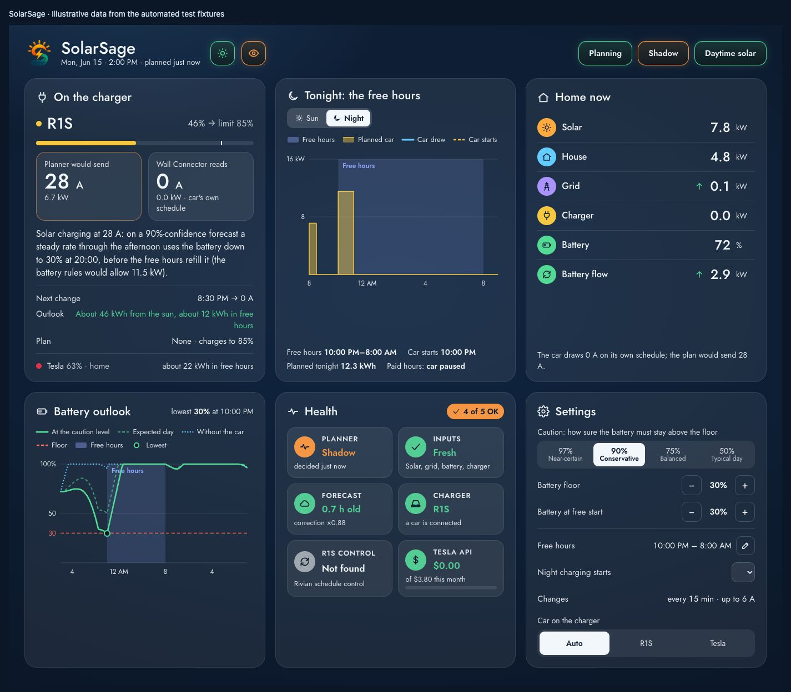

# Solar charging, planned ahead.

SolarSage is a Home Assistant integration that plans EV charging around solar forecasts, household demand, home battery reserves, and electricity prices. It supports Tesla Fleet commands and bundled Rivian schedule control, with one shared charger.

**Start with a plan you can inspect.** SolarSage installs in shadow mode. It shows the current it would choose, the reason, and the predicted battery path before you allow it to control a vehicle. Rivian schedule control also starts in dry run.

[Install SolarSage](installation.md) · [Configure your site](PLANNER.md) · [Understand the planner](PLAN.md)

## See the dashboard

The dashboard explains each charging decision, shows the predicted home battery path, and puts the main controls in one place. This screenshot uses synthetic test data.

## What you get

- Forecast-aware daytime charging with steady currents, rather than chasing every passing cloud.
- Full-current charging during your free electricity hours, subject to vehicle and charger limits.
- A home battery forecast with a configurable floor and uncertainty level.
- Per-car targets and charging deadlines.
- A dashboard that explains what is planned, why it changed, and what is holding it back.
- Rivian schedule ownership, leases, fault reporting, and restoration of the original schedules.

## Before you begin

This is experimental software. The automated suite uses simulated Home Assistant states and vehicle APIs; it does not establish real-world reliability. Follow the [staged commissioning guide](TESTING.md) before enabling commands. SolarSage is a planning controller, not an electrical protection device.

You need Home Assistant 2026.10 or later, recorder history, solar/grid/battery readings, charger power, Solcast forecasts, and vehicle telemetry. The reference setup uses a Sol-Ark inverter and a Tesla Wall Connector; other sensors must provide the same units and sign conventions. There is one site planner and one shared charger. See [requirements and compatibility](installation.md#requirements).

## Find your next answer

| I want to… | Read |
| --- | --- |
| Install or update | [Installation](installation.md) |
| Map sensors, cars, tariffs and settings | [Configuration and reference](PLANNER.md) |
| Understand the forecast and battery floor | [How it works](PLAN.md), [algorithm design](PLANNER_DESIGN.md) |
| Set up a Rivian | [Rivian schedule control](RIVIAN_SCHEDULE_CONTROL.md) |
| Compare plans with real data safely | [Commissioning](TESTING.md), [tools](TOOLS.md) |
| Diagnose a stalled or missing plan | [Troubleshooting](troubleshooting.md) |
| Contribute code or improve these pages | [Development](development.md) |
